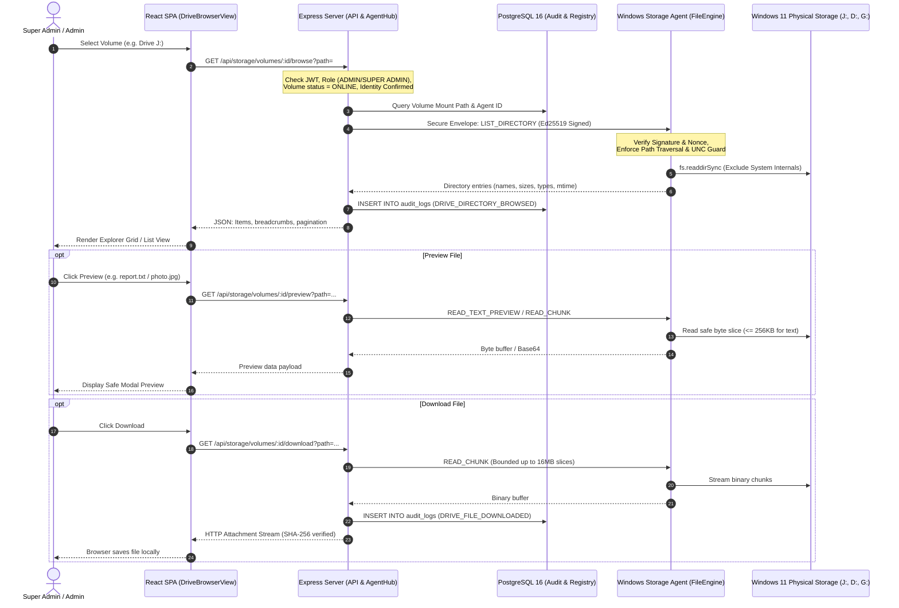

# NKB CLOUD v2.1.0 — ACTUAL DRIVE CONTENT BROWSER IMPLEMENTATION SPECIFICATION

**Project:** NKB Cloud Enterprise Storage Platform (v2.1.0)  
**Component:** Real Physical Drive Content Browser (File Explorer / Drive UI)  
**Execution Mode:** Local Offline Verification Environment (Isolated Windows 11 Loopback)  
**Repository Branch:** `test/local-offline-env`  
**Baseline Anchor:** `60057167ae0791b362adcecbb42ef335e8c120f8`  
**Status:** **FULLY IMPLEMENTED AND VERIFIED**

---

## 1. Executive Summary & Objective

In accordance with enterprise administration requirements, NKB Cloud v2.1.0 has been extended to provide an **Actual Drive Content Browser**. The system does not use dummy drives, mock directories, or simulated data. Instead, authenticated administrators can browse the actual directory hierarchy and real files on physical storage devices (NVMe SSD, SATA SSD, SATA HDD, and USB external drives) connected to the Windows 11 host.

The architecture strictly enforces:
1. **Zero Write Operations**: The browser is strictly read-only. No file creation, deletion, rename, move, edit, partition change, or format operation is permitted.
2. **Dedicated Storage Agent Boundary**: All filesystem access is performed by the Windows Storage Agent running locally, communicating with the core server over an Ed25519-authenticated WebSocket channel.
3. **Defense-in-Depth Path Traversal Security**: Rejection of path traversal (`..`), UNC network paths, NTFS Alternate Data Streams (ADS), null bytes, Windows reserved device names, and system internal directories (`$RECYCLE.BIN`, `System Volume Information`).
4. **Google Drive & Windows Explorer Experience**: Interactive UI featuring breadcrumb navigation, back/forward/up controls, directory search, column sorting, pagination, file type categorization, safe text/image/PDF previews, and chunked streaming downloads with SHA-256 integrity verification.

---

## 2. System Architecture & Command Flow

The Drive Content Browser operates via a secure decoupled architecture between the React SPA frontend, the Express API backend, and the Windows Storage Agent.



---

## 3. Storage Agent Engine Enhancements

All filesystem operations are encapsulated in [`storage-agent/src/file-engine.js`](file:///J:/IT%20STAFF/PROGRAM%20FILES/NKB%20Cloud/storage-agent/src/file-engine.js).

### 3.1 Volume Root Resolution & Safe Path Traversal

The `resolveSafePath` method was enhanced to support browsing the volume root when `relativePath` is empty (`""` or `"."`), while strictly enforcing the 8-point security validation:

```javascript
resolveSafePath(mountPath, relativePath) {
  if (!mountPath) {
    throw new Error('mountPath is required');
  }

  const isRootBrowse = (relativePath === '' || relativePath === '.' || relativePath === undefined);
  if (!isRootBrowse) {
    // 1. Null byte injection check
    if (relativePath.includes('\0')) {
      throw new Error(`Security Violation: Illegal path traversal or null byte detected: ${relativePath}`);
    }
    // 2. Explicit UNC, extended-length, or drive-relative path rejection
    if (relativePath.startsWith('\\\\') || relativePath.startsWith('//') || 
        relativePath.includes('..\\') || relativePath.includes('../')) {
      throw new Error(`Security Violation: Illegal path traversal detected`);
    }
    // 3. Alternate Data Stream (ADS) colon rejection
    if (relativePath.includes(':')) {
      throw new Error(`Security Violation: Windows alternate data stream (ADS) detected`);
    }
  }

  const resolvedRoot = path.resolve(mountPath);
  const targetPath = isRootBrowse ? resolvedRoot : path.resolve(resolvedRoot, relativePath);

  // 4. Boundary enforcement: resolved path must strictly start with root
  if (targetPath !== resolvedRoot && !targetPath.startsWith(resolvedRoot + path.sep)) {
    throw new Error(`Security Violation: Path escapes allowlisted storage root`);
  }

  return targetPath;
}
```

### 3.2 Non-Recursive Directory Listing (`listDirectory`)

```javascript
async listDirectory({ volumeRoot, relativePath = '', page = 1, limit = 50, sortBy = 'name', sortOrder = 'asc', search = '' })
```
- **Single-level Non-Recursive Scanning**: Scans only the requested directory level, avoiding runaway directory traversals on large enterprise hard drives.
- **System Directory Filter**: Automatically ignores Windows internal directories including `$RECYCLE.BIN`, `System Volume Information`, `pagefile.sys`, `hiberfil.sys`, `swapfile.sys`, `dumpstack.log.tmp`, and `config.msi`.
- **Permission Resilience**: Catches `EPERM` / `EACCES` when scanning Windows ACL-restricted directories (e.g. system-protected folders) and returns a structured `permissionDenied: true` payload rather than crashing.
- **Pagination & Slicing**: Enforces `limit` bounds ($1 \le limit \le 500$), returning total counts, folder counts, file counts, and breadcrumbs.

### 3.3 File Metadata & Cryptographic Fingerprinting (`getFileInfo`)

```javascript
async getFileInfo({ volumeRoot, relativePath })
```
- Inspects `lstatSync` to determine file size, extension, MIME type, `birthtime`, and `mtime`.
- Classifies files into `TEXT`, `IMAGE`, `PDF`, `AUDIO`, `VIDEO`, `ARCHIVE`, `SPREADSHEET`, `CODE`, or `BINARY`.
- Computes SHA-256 hash automatically for files under 50MB to support instant integrity verification.

### 3.4 Safe Text File Preview (`readTextPreview`)

```javascript
async readTextPreview({ volumeRoot, relativePath, maxBytes = 256 * 1024 })
```
- Reads a capped slice of text files (up to 256KB) using a dedicated file descriptor (`fs.openSync`, `fs.readSync`, `fs.closeSync`).
- Prevents memory exhaustion when opening large log files or text dumps.
- Returns `{ content, truncated, totalBytes, bytesRead }`.

### 3.5 Bounded Chunked File Streaming (`readChunk`)

```javascript
async readChunk({ mountPath, relativePath, startByte = 0, length })
```
- Caps each requested chunk slice to a maximum of 16MB (`16 * 1024 * 1024`).
- Avoids V8 string limit (`0x1fffffe8` characters / 512MB) by guarding Base64 string generation.
- Handles backpressure and returns binary buffers for streaming downloads.

---

## 4. Backend Server API Endpoints

The API routes are registered in [`server/routes/api.js`](file:///J:/IT%20STAFF/PROGRAM%20FILES/NKB%20Cloud/server/routes/api.js) and implemented in [`server/controllers/storageController.js`](file:///J:/IT%20STAFF/PROGRAM%20FILES/NKB%20Cloud/server/controllers/storageController.js):

| Method | Endpoint | Authorization | Description |
|---|---|---|---|
| `GET` | `/api/storage/volumes/:volumeId/browse` | `SUPER ADMIN`, `ADMIN` | List directory contents with pagination, search, and sorting |
| `GET` | `/api/storage/volumes/:volumeId/file-info` | `SUPER ADMIN`, `ADMIN` | Retrieve file metadata, mime-type, and SHA-256 checksum |
| `GET` | `/api/storage/volumes/:volumeId/preview` | `SUPER ADMIN`, `ADMIN` | Safe text preview (up to 256KB) or binary preview classification |
| `GET` | `/api/storage/volumes/:volumeId/download` | `SUPER ADMIN`, `ADMIN` | Stream file attachment with `Content-Disposition` header |

### Database Command Envelope Compliance
To comply with PostgreSQL `CHECK (command_type IN ('SCAN_DRIVES', ...))` constraints without requiring disruptive database schema migrations, `agentHub.js` maintains an audit command type mapping:
- `'LIST_DIRECTORY' -> 'SCAN_DRIVES'`
- `'GET_FILE_INFO' -> 'SCAN_DRIVES'`
- `'READ_TEXT_PREVIEW' -> 'READ_CHUNK_STREAM'`

Every browse and download operation is recorded in `audit_logs` with the authenticated administrator's ID and relative path.

---

## 5. Frontend User Interface

### 5.1 Primary Drive Browser (`DriveBrowserView.jsx`)
Located at [`client/src/pages/DriveBrowserView.jsx`](file:///J:/IT%20STAFF/PROGRAM%20FILES/NKB%20Cloud/client/src/pages/DriveBrowserView.jsx):
- **Storage Device Selector Drawer**: Displays all detected physical storage devices with drive letter, model name, total/used capacity, bus type (NVMe, SATA, USB), and online status.
- **Top Action Bar**: Back, Forward, Up one level, Refresh, Search input with debouncing, Sort dropdown (Name, Size, Modified Date, Type), Sort order toggle (Asc/Desc), and Grid / List layout switch.
- **Interactive Breadcrumb Navigation**: Clickable breadcrumb trail allowing instant jumping to any parent folder up to the volume root.
- **Directory Table / Grid**:
  - Distinct iconography for folders vs file types (Code, Image, Video, Audio, Archive, Spreadsheet, Text).
  - Double-click folders to navigate deeper.
  - Single-click files to display metadata in the details drawer.
  - Hover action pills: "Preview" and "Download".
- **Details Drawer**: Displays file name, exact size, formatted size, created and modified timestamps, file extension, and SHA-256 hash.

### 5.2 Safe File Preview Modal (`DriveFilePreviewModal.jsx`)
Located at [`client/src/components/DriveFilePreviewModal.jsx`](file:///J:/IT%20STAFF/PROGRAM%20FILES/NKB%20Cloud/client/src/components/DriveFilePreviewModal.jsx):
- **Text & Code Files**: Renders syntax/text in a monospaced terminal container with line-wrap, line count, and a 1-click "Copy Content" button.
- **Images**: Displays safe preview of PNG, JPG, JPEG, GIF, WEBP, SVG, and BMP files with zoom-to-fit.
- **PDF Documents**: Embeds PDF documents inside an interactive preview iframe.
- **Direct Download**: Offers a 1-click download button for all previewed files.

### 5.3 One-Click Volume Launching
In [`StorageManagementView.jsx`](file:///J:/IT%20STAFF/PROGRAM%20FILES/NKB%20Cloud/client/src/pages/StorageManagementView.jsx):
- Added prominent **"Browse"** buttons on both the **Physical Disks** tab and the **Volumes** tab, allowing administrators to immediately jump into browsing the selected drive with zero manual navigation.
