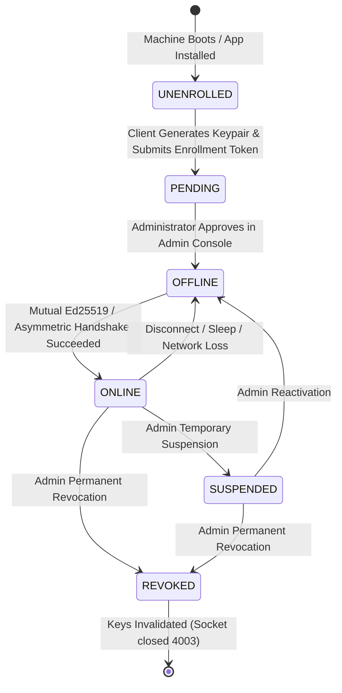

# NKB CLOUD v2.1.0 — CROSS-PLATFORM & MOBILE ECOSYSTEM ARCHITECTURE

**Document Version:** 1.0.0  
**Target Ecosystem:** Windows 10/11, macOS (Swift), Android (Kotlin), iOS (Swift), Responsive Web  
**Central Ingress:** AlmaLinux 10 Hostinger VPS with Nginx 1.26.3 Stable  
**Backend Runtime:** Node.js 26.13.0 LTS / Express / PostgreSQL 16.15  
**Protocol Version:** `NKB-AUTH-V1` / `NKB-CMD-V1` (Protocol 2.1.0)  
**Cryptographic Primitives:** Ed25519, Curve25519, Android Keystore, Apple Keychain Services, SHA-256  

---

## 1. ARCHITECTURAL OVERVIEW & PURPOSE

The **NKB Cloud Cross-Platform Ecosystem** transforms NKB Cloud from a local Windows storage platform into a unified enterprise cloud storage environment supporting corporate workstations, laptops, and mobile devices:

```
                                  +---------------------------------------+
                                  |         NKB CLOUD PRODUCTION VPS      |
                                  |        (Hostinger AlmaLinux 10)       |
                                  |                                       |
                                  |   +-------------------------------+   |
                                  |   |   Nginx 1.26.3 Stable Proxy   |   |
                                  |   |  (TLS 1.3 / HSTS / Rate Limit)|   |
                                  |   +---------------+---------------+   |
                                  |                   |                   |
                                  |   +---------------v---------------+   |
                                  |   |   Node.js 26 Express Backend  |   |
                                  |   |  (DeviceHub / WSS / REST APIs)|   |
                                  |   +---------------+---------------+   |
                                  |                   |                   |
                                  |   +---------------v---------------+   |
                                  |   |  PostgreSQL 16 DB (179 logs)  |   |
                                  |   +-------------------------------+   |
                                  +-------------------+-------------------+
                                                      |
                   +----------------------------------+----------------------------------+
                   |                                  |                                  |
     WSS /ws/agent |                    HTTPS REST    |                    HTTPS REST    |
+------------------v------------------+  +------------v---------------------+  +---------v--------------------------+
|      CORPORATE WORKSTATIONS         |  |          MOBILE ECOSYSTEM        |  |        RESPONSIVE WEB APP          |
|                                     |  |                                  |  |                                    |
| 1. Windows 10/11 Storage Agent      |  | 3. Android Native App (Kotlin)   |  | 5. React 18 + Tailwind CSS         |
|    - Node.js Service (NSSM)         |  |    - Jetpack Compose / M3        |  |    - Desktop (Chrome/Edge/Safari)  |
|    - DPAPI Local Ed25519 Keypair    |  |    - Android Keystore Hardware   |  |    - Mobile Drawer (iOS Safari)    |
|    - Loopback (127.0.0.1:51248)     |  |    - BiometricPrompt (Finger/Face|  |    - Mobile Drawer (Android Chrome)|
|                                     |  |    - WorkManager Background Sync |  |    - Touch-optimized file actions  |
| 2. macOS Storage Agent (Swift)      |  |                                  |  +------------------------------------+
|    - Native Swift 5.9 Binary        |  | 4. iOS / iPhone Native App(Swift)|
|    - Apple Keychain Services        |  |    - SwiftUI NavigationStack     |
|    - CryptoKit Ed25519 Mutual Auth  |  |    - LocalAuthentication (FaceID)|
|    - FSEvents Local Folder Sync     |  |    - Apple Files App Provider    |
|    - launchd Daemon Execution       |  |    - URLSession Background Sync  |
+-------------------------------------+  +----------------------------------+
```

---

## 2. CROSS-PLATFORM CLIENT ARCHITECTURE SPECIFICATIONS

### 2.1 Windows 10/11 Storage Agent
- **Implementation:** [`storage-agent/`](file:///J:/IT%20STAFF/PROGRAM%20FILES/NKB%20Cloud/storage-agent/)
- **Runtime:** Node.js 26 LTS service daemon managed via NSSM or native `sc.exe`.
- **Security Storage:** Windows DPAPI / NTFS ACLs restricting key access to `SYSTEM` and Administrator.
- **Protocol:** Outbound WebSocket (`/ws/agent`) with Ed25519 mutual authentication challenge-response.
- **Local Probing:** Embedded loopback server on `http://127.0.0.1:51248/status`.

### 2.2 macOS Native Storage Agent (Swift)
- **Implementation:** [`macos-agent/`](file:///J:/IT%20STAFF/PROGRAM%20FILES/NKB%20Cloud/macos-agent/)
- **Runtime:** Native compiled Swift 5.9 executable for macOS 13.0+ (Ventura, Sonoma, Sequoia).
- **Security Storage:** Apple Keychain Services (`Security.framework`) with `kSecAttrAccessibleAfterFirstUnlockThisDeviceOnly`.
- **Cryptographic Engine:** Apple `CryptoKit` (`Curve25519.Signing.PrivateKey` / `PublicKey`).
- **File System Monitoring:** `FSEvents` API for sub-millisecond local folder change notifications.
- **Daemon Execution:** Managed via `launchd` (`~/Library/LaunchAgents/com.nkb.storageagent.plist`).

### 2.3 Android Native Mobile Application (Kotlin)
- **Implementation:** [`android-client/`](file:///J:/IT%20STAFF/PROGRAM%20FILES/NKB%20Cloud/android-client/)
- **Runtime:** Android 8.0 (API 26) through Android 14+ (API 34).
- **UI Framework:** Jetpack Compose with Material 3 design system.
- **Security Storage:** Hardware-backed Android Keystore (`AndroidKeyStore`) + EncryptedSharedPreferences (AES-256-GCM).
- **Biometric Authentication:** `androidx.biometric.BiometricPrompt` supporting Fingerprint and Face Unlock.
- **Background Synchronization:** `WorkManager` (`FileUploadSyncWorker`) enforcing network unmetered & battery constraints.
- **Deep-Link Protocol:** `nkbcloud://enroll?token=...&server=...` for zero-friction provisioning.

### 2.4 iOS / iPhone Native Mobile Application (Swift)
- **Implementation:** [`ios-client/`](file:///J:/IT%20STAFF/PROGRAM%20FILES/NKB%20Cloud/ios-client/)
- **Runtime:** iOS 16.0+ (iPhone and iPad).
- **UI Framework:** SwiftUI with adaptive layouts for iPhone Dynamic Island and iPad Stage Manager.
- **Security Storage:** iOS Keychain Services.
- **Biometric Authentication:** Apple `LocalAuthentication` supporting Face ID and Touch ID.
- **Files App Integration:** `NSFileProviderReplicatedExtension` exposing NKB Cloud directly inside iOS Files.
- **Background Transfers:** `URLSessionConfiguration.background` for downloads/uploads when app is suspended.

### 2.5 Responsive Web Application
- **Implementation:** [`client/`](file:///J:/IT%20STAFF/PROGRAM%20FILES/NKB%20Cloud/client/)
- **Desktop Viewport:** Full sidebar with storage graphs, collapsible subcategories, multi-column file explorer.
- **Mobile Viewport:** Off-canvas responsive navigation drawer (`isOpen` backdrop toggle), touch-friendly buttons (min 44px), card-based device management and file action modals.

---

## 3. UNIFIED DEVICE ENROLLMENT & GOVERNANCE LIFECYCLE

All endpoint platforms follow the identical zero-trust lifecycle managed by [`server/services/deviceService.js`](file:///J:/IT%20STAFF/PROGRAM%20FILES/NKB%20Cloud/server/services/deviceService.js):

$$\text{PENDING} \xrightarrow{\text{Admin Approval}} \text{OFFLINE} \xrightarrow{\text{Handshake}} \text{ONLINE} \xrightarrow{\text{Kill Switch}} \text{REVOKED}$$



---

## 4. SECURITY BOUNDARIES & ZERO-TRUST GUARANTEES

1. **Zero Private Key Exposure:** Private keys are generated locally within endpoint hardware (Windows DPAPI, macOS Keychain, Android Keystore, iOS Secure Enclave). Cloud servers store only public keys.
2. **Replay Protection Across All Platforms:** All authentication exchanges use single-use cryptographic nonces verified against PostgreSQL `agent_nonce_registry` with unique constraints.
3. **Session Invalidation:** Any user password change or administrative role update increments `session_version` in PostgreSQL, immediately invalidating active JWTs on Windows, Mac, Android, iPhone, and Web browsers.
4. **Immediate Kill-Switch Revocation:** One-click revocation terminates active WebSockets in real time and marks `agent_credentials` as `REVOKED`.
5. **Continuous Audit Chaining:** All lifecycle events are logged to the PostgreSQL `audit_logs` table protected by trigger-enforced SHA-256 hash chains (currently 179 records verified continuous).
