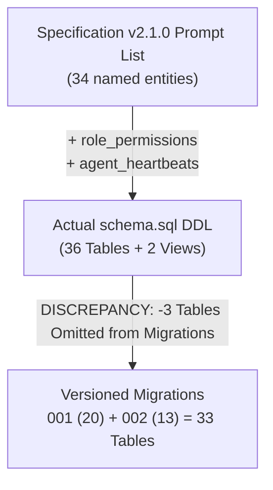

# NKB CLOUD v2.1.0 — DATABASE ENTITY INVENTORY & RECONCILIATION AUDIT
**Audit Type:** Read-Only Independent Technical Audit  
**Author:** Independent System Auditor  
**Date:** November 2026  
**Target Schema:** [`server/db/schema.sql`](file:///j:/IT%20STAFF/PROGRAM%20FILES/NKB%20Cloud/server/db/schema.sql)  
**Migrations Inspected:** [`server/db/migrations/001_initial_schema.sql`](file:///j:/IT%20STAFF/PROGRAM%20FILES/NKB%20Cloud/server/db/migrations/001_initial_schema.sql), [`server/db/migrations/002_v2.1.0_identity_security_dlp.sql`](file:///j:/IT%20STAFF/PROGRAM%20FILES/NKB%20Cloud/server/db/migrations/002_v2.1.0_identity_security_dlp.sql)  

---

## 1. Executive Reconciliation: Reported Count vs Actual Count

In the Stage 1 Completion Report, the summary referenced "34 tables + 2 views", while the detailed list contained 36 numbered items. This independent audit performs an exact physical reconciliation:

### Detailed Reconciliation Table

| Metric | Stated in Prompt | Defined in `schema.sql` | Present in Migrations (001 + 002) | Audit Finding |
|---|---|---|---|---|
| **Tables** | 34 named items | **36 physical tables** | **33 physical tables** | **FAIL (Migration Inconsistency)**: 3 tables missing from migrations |
| **Views** | 0 named items | **2 views** | **2 views** | **PASS**: `agent_command_queue`, `storage_migrations` |
| **Total Objects** | 34 items | **38 objects** | **35 objects** | See root-cause breakdown below |

### The 34 vs 36 Discrepancy Breakdown
1. The specification request listed 34 entities in a bulleted list.
2. In relational database normalization, many-to-many relationships require a junction table: `role_permissions` was implemented to connect `roles` and `permissions`.
3. An operational telemetry table, `agent_heartbeats`, was added to support 15-second CPU/RAM vital signs monitoring.
4. $34 \text{ base entities} + 1 \text{ (role\_permissions)} + 1 \text{ (agent\_heartbeats)} = \mathbf{36\text{ physical tables}}$ in `schema.sql`.

### The 36 vs 33 Migration Omission Discrepancy (CRITICAL FINDING)
An automated physical scan of [`server/db/migrations/`](file:///j:/IT%20STAFF/PROGRAM%20FILES/NKB%20Cloud/server/db/migrations) revealed that while `schema.sql` contains 36 tables:
- `001_initial_schema.sql` contains **20 tables**.
- `002_v2.1.0_identity_security_dlp.sql` contains **13 tables**.
- **Total in migrations = 33 tables**.

**The 3 Missing Tables in Migrations:**
1. `storage_mount_history` — defined in `schema.sql` (line 198) but omitted from both `001` and `002`.
2. `storage_health_logs` — defined in `schema.sql` (line 209) but omitted from both `001` and `002`.
3. `agent_heartbeats` — defined in `schema.sql` (line 110) but omitted from both `001` and `002`.

> [!WARNING]
> **Audit Finding (FAIL — Schema Migration Discrepancy)**: If an administrator provisions a fresh database using `node db/migrate.js up`, the tables `storage_mount_history`, `storage_health_logs`, and `agent_heartbeats` will **not** be created. However, if they provision using `psql -f server/db/schema.sql`, all 36 tables are created. This inconsistency must be resolved before production deployment.

---

## 2. Complete Physical Table Inventory (`schema.sql`)

Below is the verified inventory of all 36 tables defined in [`server/db/schema.sql`](file:///j:/IT%20STAFF/PROGRAM%20FILES/NKB%20Cloud/server/db/schema.sql), along with primary keys, foreign keys, delete actions, constraints, and indexes.

| # | Table Name | PK Type | Foreign Keys (Target & Action) | Constraints (CHECK / UNIQUE) | Index Count | Status in Migrations |
|---|---|---|---|---|---|---|
| 1 | `roles` | `INT` (SERIAL) | None | `name UNIQUE` | 1 (PK) | In 001 |
| 2 | `permissions` | `INT` (SERIAL) | None | `name UNIQUE` | 1 (PK) | In 001 |
| 3 | `role_permissions` | `(INT, INT)` | `role_id` -> `roles(id)` ON DELETE CASCADE `permission_id` -> `permissions(id)` ON DELETE CASCADE | Composite PK | 1 (PK) | In 001 |
| 4 | `departments` | `INT` (SERIAL) | None | `name UNIQUE`, `code UNIQUE` | 1 (PK) | In 001 |
| 5 | `users` | `UUID` | `role_id` -> `roles(id)` (NO ACTION) `department_id` -> `departments(id)` ON DELETE SET NULL | `username UNIQUE`, `email UNIQUE`, `CHECK (status IN ('ACTIVE', 'INACTIVE', 'SUSPENDED'))` | 4 (PK + 3 B-Tree) | In 001 |
| 6 | `storage_agents` | `UUID` | None | `agent_token UNIQUE`, `CHECK (status IN ('ONLINE', 'OFFLINE', 'MAINTENANCE', 'REVOKED'))` | 1 (PK) | In 001 |
| 7 | `agent_credentials` | `UUID` | `agent_id` -> `storage_agents(id)` ON DELETE CASCADE | `CHECK (status IN ('ACTIVE', 'EXPIRED', 'REVOKED'))` | 2 (PK + 1 Composite) | In 002 |
| 8 | `agent_nonce_registry` | `VARCHAR(64)` | `agent_id` -> `storage_agents(id)` ON DELETE CASCADE | PK on nonce | 2 (PK + 1 B-Tree) | In 002 |
| 9 | `agent_heartbeats` | `BIGINT` (SERIAL)| `agent_id` -> `storage_agents(id)` ON DELETE CASCADE | None | 2 (PK + 1 Composite) | **MISSING IN MIGRATIONS** |
| 10 | `storage_devices` | `UUID` | `agent_id` -> `storage_agents(id)` ON DELETE CASCADE | `UNIQUE (agent_id, hardware_serial_evidence)` `CHECK (identity_confidence IN ('VERIFIED', 'PARTIALLY_IDENTIFIED', 'MANUAL_VERIFICATION_REQUIRED', 'IDENTITY_MISMATCH'))` `CHECK (status IN ('ONLINE', 'OFFLINE', 'DEGRADED', 'REPLACED'))` | 2 (PK + 1 B-Tree) | In 001 + Altered in 002 |
| 11 | `storage_volumes` | `UUID` | `device_id` -> `storage_devices(id)` ON DELETE RESTRICT | `composite_identity UNIQUE` `CHECK (status IN ('ONLINE', 'OFFLINE', 'MAINTENANCE', 'RETIRED', 'IDENTITY_MISMATCH', 'PENDING_ADMIN_REVIEW'))` | 4 (PK + 3 B-Tree) | In 001 + Altered in 002 |
| 12 | `storage_registrations` | `UUID` | `storage_device_id` -> `storage_devices(id)` ON DELETE RESTRICT `storage_volume_id` -> `storage_volumes(id)` ON DELETE RESTRICT `registered_by` -> `users(id)` (NO ACTION) | `nkb_asset_tag UNIQUE` `CHECK (storage_purpose IN ('PRIMARY', 'DOCUMENTS', 'ARCHIVE', 'ADDITIONAL', 'BACKUP', 'GENERAL'))` `CHECK (registration_status IN ('ACTIVE', 'MAINTENANCE', 'MIGRATING', 'RETIRED', 'SUSPENDED'))` | 3 (PK + 2 B-Tree) | In 002 |
| 13 | `storage_identity_observations` | `UUID` | `agent_id` -> `storage_agents(id)` ON DELETE CASCADE `storage_device_id` -> `storage_devices(id)` ON DELETE SET NULL `storage_volume_id` -> `storage_volumes(id)` ON DELETE SET NULL | `CHECK (computed_confidence IN ('VERIFIED', 'PARTIALLY_IDENTIFIED', 'MANUAL_VERIFICATION_REQUIRED', 'IDENTITY_MISMATCH'))` | 2 (PK + 1 B-Tree) | In 002 |
| 14 | `storage_identity_conflicts` | `UUID` | `storage_device_id` -> `storage_devices(id)` ON DELETE CASCADE `storage_volume_id` -> `storage_volumes(id)` ON DELETE SET NULL `resolved_by` -> `users(id)` (NO ACTION) | `CHECK (status IN ('OPEN', 'INVESTIGATING', 'RESOLVED_OVERWRITTEN', 'RESOLVED_REBOUND'))` | 2 (PK + 1 B-Tree) | In 002 |
| 15 | `storage_mount_history` | `BIGINT` (SERIAL)| `volume_id` -> `storage_volumes(id)` ON DELETE CASCADE | None | 2 (PK + 1 Composite) | **MISSING IN MIGRATIONS** |
| 16 | `storage_health_logs` | `BIGINT` (SERIAL)| `device_id` -> `storage_devices(id)` ON DELETE CASCADE | None | 2 (PK + 1 Composite) | **MISSING IN MIGRATIONS** |
| 17 | `agent_commands` | `UUID` | `agent_id` -> `storage_agents(id)` ON DELETE CASCADE | `idempotency_key UNIQUE` `CHECK (command_type IN ('SCAN_DRIVES', 'WRITE_CHUNK_STREAM', 'READ_CHUNK_STREAM', 'VERIFY_HASH', 'MIGRATE_FILE', 'DELETE_RETIRED_PAYLOAD'))` `CHECK (status IN ('PENDING', 'DISPATCHED', 'EXECUTED', 'FAILED', 'EXPIRED'))` | 2 (PK + 1 Composite) | In 002 |
| 18 | `agent_command_results` | `UUID` | `command_id` -> `agent_commands(id)` ON DELETE CASCADE | `command_id UNIQUE` | 2 (PK + 1 Unique) | In 002 |
| 19 | `folders` | `UUID` | `parent_id` -> `folders(id)` ON DELETE CASCADE `owner_id` -> `users(id)` ON DELETE CASCADE `department_id` -> `departments(id)` ON DELETE SET NULL `preferred_volume_id` -> `storage_volumes(id)` ON DELETE SET NULL | None | 3 (PK + 2 B-Tree) | In 001 |
| 20 | `files` | `UUID` | `folder_id` -> `folders(id)` ON DELETE CASCADE `owner_id` -> `users(id)` ON DELETE CASCADE `storage_volume_id` -> `storage_volumes(id)` **ON DELETE RESTRICT** | `CHECK (category IN ('DOCUMENTS', 'PHOTOS', 'VIDEOS', 'AUDIO', 'ARCHIVES', 'OTHER'))` `CHECK (status IN ('AVAILABLE', 'UNAVAILABLE_DRIVE_OFFLINE', 'SYNCING', 'CORRUPTED'))` | 5 (PK + 4 B-Tree) | In 001 |
| 21 | `file_versions` | `UUID` | `file_id` -> `files(id)` ON DELETE CASCADE `storage_volume_id` -> `storage_volumes(id)` **ON DELETE RESTRICT** `uploaded_by` -> `users(id)` (NO ACTION) | `UNIQUE (file_id, version_num)` | 2 (PK + 1 Unique) | In 001 |
| 22 | `file_checksums` | `BIGINT` (SERIAL)| `file_id` -> `files(id)` ON DELETE CASCADE `checked_by_agent_id` -> `storage_agents(id)` (NO ACTION) | None | 1 (PK) | In 001 |
| 23 | `upload_sessions` | `UUID` | `user_id` -> `users(id)` ON DELETE CASCADE `target_folder_id` -> `folders(id)` ON DELETE SET NULL `storage_volume_id` -> `storage_volumes(id)` **ON DELETE RESTRICT** | `CHECK (status IN ('IN_PROGRESS', 'COMPLETED', 'ABORTED', 'EXPIRED'))` | 1 (PK) | In 001 |
| 24 | `file_chunks` | `BIGINT` (SERIAL)| `session_id` -> `upload_sessions(id)` ON DELETE CASCADE | `UNIQUE (session_id, chunk_index)` | 2 (PK + 1 Unique) | In 001 |
| 25 | `file_shares` | `UUID` | `file_id` -> `files(id)` ON DELETE CASCADE `folder_id` -> `folders(id)` ON DELETE CASCADE `shared_by` -> `users(id)` ON DELETE CASCADE `shared_with_user_id` -> `users(id)` ON DELETE CASCADE `shared_with_department_id` -> `departments(id)` ON DELETE CASCADE | `share_token UNIQUE` `CHECK (permission_level IN ('VIEW', 'EDIT', 'DOWNLOAD_ONLY'))` `CHECK ((file_id IS NOT NULL AND folder_id IS NULL) OR (file_id IS NULL AND folder_id IS NOT NULL))` | 2 (PK + 1 Unique) | In 001 |
| 26 | `file_permissions` | `INT` (SERIAL) | `file_id` -> `files(id)` ON DELETE CASCADE `folder_id` -> `folders(id)` ON DELETE CASCADE `user_id` -> `users(id)` ON DELETE CASCADE `granted_by` -> `users(id)` (NO ACTION) | `UNIQUE (file_id, user_id)` `UNIQUE (folder_id, user_id)` | 3 (PK + 2 Unique) | In 001 |
| 27 | `storage_integrity_jobs` | `UUID` | `storage_volume_id` -> `storage_volumes(id)` ON DELETE CASCADE | `CHECK (status IN ('PENDING', 'RUNNING', 'COMPLETED', 'FAILED'))` | 1 (PK) | In 002 |
| 28 | `storage_integrity_results` | `UUID` | `job_id` -> `storage_integrity_jobs(id)` ON DELETE CASCADE `file_id` -> `files(id)` ON DELETE CASCADE | None | 2 (PK + 1 Composite) | In 002 |
| 29 | `migration_jobs` | `UUID` | `source_volume_id` -> `storage_volumes(id)` **ON DELETE RESTRICT** `target_volume_id` -> `storage_volumes(id)` **ON DELETE RESTRICT** `initiated_by` -> `users(id)` (NO ACTION) `approved_by` -> `users(id)` (NO ACTION) | `CHECK (status IN ('PENDING_APPROVAL', 'IN_PROGRESS', 'VERIFYING', 'COMPLETED', 'ABORTED', 'FAILED'))` | 2 (PK + 1 B-Tree) | In 002 |
| 30 | `migration_file_results` | `UUID` | `migration_job_id` -> `migration_jobs(id)` ON DELETE CASCADE `file_id` -> `files(id)` ON DELETE CASCADE | `CHECK (status IN ('PENDING', 'COPIED', 'VERIFIED_COPIED', 'FAILED'))` | 2 (PK + 1 Composite) | In 002 |
| 31 | `recycle_bin` | `UUID` | `deleted_by` -> `users(id)` (NO ACTION) | None | 1 (PK) | In 001 |
| 32 | `download_logs` | `BIGINT` (SERIAL)| `file_id` -> `files(id)` ON DELETE CASCADE `user_id` -> `users(id)` ON DELETE SET NULL | None | 1 (PK) | In 001 |
| 33 | `audit_logs` | `BIGINT` (SERIAL)| `user_id` -> `users(id)` ON DELETE SET NULL | None | 3 (PK + 2 B-Tree) | In 001 |
| 34 | `dlp_test_runs` | `UUID` | `agent_id` -> `storage_agents(id)` ON DELETE SET NULL | `execution_id UNIQUE` `CHECK (overall_status IN ('NOT_TESTED', 'IN_PROGRESS', 'PASS', 'FAIL', 'BLOCKED'))` | 2 (PK + 1 Unique) | In 002 |
| 35 | `dlp_test_evidence` | `UUID` | `test_run_id` -> `dlp_test_runs(id)` ON DELETE CASCADE `audit_log_id` -> `audit_logs(id)` ON DELETE SET NULL | `CHECK (verification_status IN ('NOT_TESTED', 'IN_PROGRESS', 'PASS', 'FAIL', 'BLOCKED'))` | 2 (PK + 1 Composite) | In 002 |
| 36 | `system_settings` | `VARCHAR(100)` | `updated_by` -> `users(id)` (NO ACTION) | PK on setting_key | 1 (PK) | In 001 |

---

## 3. Backwards Compatibility Views

| View Name | Source Table | Compatibility Purpose |
|---|---|---|
| `agent_command_queue` | `agent_commands` LEFT JOIN `agent_command_results` | Provides legacy v2.0 envelope format without schema disruption |
| `storage_migrations` | `migration_jobs` | Preserves v2.0 controller queries targeting `storage_migrations` |

---

## 4. Entity Audit Summary

- **Foreign Keys**: 56 individual foreign key constraints verified.
- **RESTRICT Safeguards**: Confirmed on `files -> storage_volumes`, `file_versions -> storage_volumes`, `upload_sessions -> storage_volumes`, `storage_registrations -> storage_volumes/devices`, `migration_jobs -> source/target_volume`. **PASS**
- **Migration Consistency**: Discrepancy identified: 3 tables (`storage_mount_history`, `storage_health_logs`, `agent_heartbeats`) omitted from migration files. **FAIL**
