# NKB CLOUD – DATABASE ENTITY-RELATIONSHIP DIAGRAM (ERD)
## Version 2.1.0-PROD – Complete Architecture Schema
**Organization:** NKB Manufacturing  
**Database Engine:** PostgreSQL 16  
**Total Entities:** 34 Tables + 2 Compatibility Views  

---

## 1. Visual Entity-Relationship Diagram

```mermaid
erDiagram
    %% Identity & Access Management
    roles ||--o{ users : assigns
    departments ||--o{ users : belongs_to
    roles ||--o{ role_permissions : grants
    permissions ||--o{ role_permissions : granted_via

    %% Agent Security & Communications
    storage_agents ||--o{ agent_credentials : authenticates
    storage_agents ||--o{ agent_nonce_registry : validates_nonces
    storage_agents ||--o{ agent_heartbeats : logs_vital_signs
    storage_agents ||--o{ agent_commands : dispatches
    agent_commands ||--o| agent_command_results : produces_result

    %% 3-Layer Storage Identities
    storage_agents ||--o{ storage_devices : detects
    storage_devices ||--o{ storage_volumes : partitions_into
    storage_devices ||--o{ storage_identity_observations : inspected_by
    storage_devices ||--o{ storage_identity_conflicts : subject_to
    storage_devices ||--o{ storage_health_logs : reports_smart
    storage_volumes ||--o{ storage_mount_history : tracks_mounts
    storage_devices ||--o| storage_registrations : bound_in
    storage_volumes ||--o| storage_registrations : assigned_in

    %% Files, Versions & Hierarchies
    users ||--o{ folders : owns
    folders ||--o{ folders : parent_child
    users ||--o{ files : owns
    folders ||--o{ files : contains
    storage_volumes ||--o{ files : stores_physically
    files ||--o{ file_versions : revisions
    files ||--o{ file_checksums : verified_by
    storage_volumes ||--o{ file_versions : stored_on

    %% Binary Resumable Streaming
    users ||--o{ upload_sessions : initiates
    storage_volumes ||--o{ upload_sessions : target_volume
    upload_sessions ||--o{ file_chunks : chunks_streamed

    %% Sharing & Access Control
    files ||--o{ file_shares : shared_via
    folders ||--o{ file_shares : shared_via
    files ||--o{ file_permissions : explicit_acl
    folders ||--o{ file_permissions : explicit_acl

    %% Integrity Auditing & Safe Resumable Migration
    storage_volumes ||--o{ storage_integrity_jobs : audited_by
    storage_integrity_jobs ||--o{ storage_integrity_results : generates
    files ||--o{ storage_integrity_results : checked_file
    storage_volumes ||--o{ migration_jobs : source_volume
    storage_volumes ||--o{ migration_jobs : target_volume
    migration_jobs ||--o{ migration_file_results : transfers_file
    files ||--o{ migration_file_results : migrated_item

    %% Logs, DLP Evidence & System
    users ||--o{ download_logs : logged_for
    files ||--o{ download_logs : file_downloaded
    users ||--o{ audit_logs : action_by
    users ||--o{ recycle_bin : deleted_by
    dlp_test_runs ||--o{ dlp_test_evidence : records_evidence
    audit_logs ||--o{ dlp_test_evidence : references_audit

    roles {
        int id PK
        string name UK
        string description
    }

    permissions {
        int id PK
        string name UK
        string module
        string description
    }

    role_permissions {
        int role_id PK,FK
        int permission_id PK,FK
    }

    departments {
        int id PK
        string name UK
        string code UK
        string description
    }

    users {
        uuid id PK
        string username UK
        string email UK
        string password_hash
        string full_name
        int role_id FK
        int department_id FK
        string status
        bigint storage_quota_bytes
        bigint used_storage_bytes
    }

    storage_agents {
        uuid id PK
        string agent_name
        string machine_name
        string agent_token UK
        string status
        string version
        timestamp last_heartbeat
    }

    agent_credentials {
        uuid id PK
        uuid agent_id FK
        string hmac_secret_hash
        int key_version
        string status
        timestamp expires_at
    }

    agent_nonce_registry {
        string nonce PK
        uuid agent_id FK
        timestamp expires_at
    }

    storage_devices {
        uuid id PK
        uuid agent_id FK
        string hardware_serial_evidence
        string disk_unique_id_evidence
        string vendor
        string model
        string bus_type
        bigint total_capacity_bytes
        string identity_confidence
        string status
    }

    storage_volumes {
        uuid id PK
        uuid device_id FK
        string volume_guid
        string partition_guid
        string filesystem_uuid
        bigint partition_offset_bytes
        string current_drive_letter
        string mount_path
        string composite_identity UK
        bigint total_bytes
        bigint used_bytes
        bigint free_bytes
        string status
    }

    storage_registrations {
        uuid id PK
        string nkb_asset_tag UK
        uuid storage_device_id FK
        uuid storage_volume_id FK
        string assigned_name
        string storage_purpose
        int priority
        boolean is_default
        string registration_status
    }

    agent_commands {
        uuid id PK
        uuid agent_id FK
        string command_type
        string idempotency_key UK
        jsonb payload
        string status
        timestamp expires_at
    }

    agent_command_results {
        uuid id PK
        uuid command_id FK
        boolean success
        jsonb result_payload
        string error_message
    }

    storage_integrity_jobs {
        uuid id PK
        uuid storage_volume_id FK
        string status
        bigint total_files_scanned
        int corrupt_files_count
    }

    storage_integrity_results {
        uuid id PK
        uuid job_id FK
        uuid file_id FK
        string recorded_sha256
        string actual_sha256
        boolean is_match
    }

    migration_jobs {
        uuid id PK
        uuid source_volume_id FK
        uuid target_volume_id FK
        string status
        bigint total_files
        bigint migrated_files
        bigint total_bytes
        bigint verified_bytes
    }

    migration_file_results {
        uuid id PK
        uuid migration_job_id FK
        uuid file_id FK
        string source_sha256
        string target_sha256
        string status
    }

    dlp_test_runs {
        uuid id PK
        string test_suite_name
        string execution_id UK
        string overall_status
    }

    dlp_test_evidence {
        uuid id PK
        uuid test_run_id FK
        string requirement_key
        text test_procedure
        text expected_result
        string verification_status
        string relevant_sha256
    }
```

---

## 2. Entity Specifications by Functional Module

### Module 1: Identity & Access Management (IAM)
- **`roles`**: System roles (`SUPER ADMIN`, `ADMIN`, `STANDARD USER`, `VIEWER`).
- **`permissions`**: Granular functional privileges across 7 modules.
- **`role_permissions`**: Many-to-many junction binding roles to permissions.
- **`departments`**: NKB enterprise departments (Executive, IT, Manufacturing, QA, Engineering, Finance/HR).
- **`users`**: User identities, bcrypt hashed credentials, quota constraints, and status.

### Module 2: Storage Agent Security & Command Queue
- **`storage_agents`**: Registered Windows background host agents.
- **`agent_credentials`**: HMAC-SHA256 secrets, key versions, expiration, and revocation status for mutual challenge-response authentication.
- **`agent_nonce_registry`**: Replay attack prevention registry holding issued nonces with strict TTL.
- **`agent_heartbeats`**: Historical CPU, RAM, and drive count metrics recorded every 15 seconds.
- **`agent_commands`**: Typed, signed, and expiring command envelopes (`SCAN_DRIVES`, `WRITE_CHUNK_STREAM`, `READ_CHUNK_STREAM`, `VERIFY_HASH`, `MIGRATE_FILE`, `DELETE_RETIRED_PAYLOAD`).
- **`agent_command_results`**: Immutable execution results linked 1-to-1 with command envelopes.

### Module 3: 3-Layer Storage Identities
- **`storage_devices` (Layer 1 - Physical Disk)**: Tracks physical disk enclosure, bus type (NVMe, SATA, USB), hardware serial evidence, disk unique ID evidence, and identity confidence level.
- **`storage_volumes` (Layer 2 - Filesystem Volume)**: Tracks filesystem container, Volume GUID (`\\?\Volume{...}\`), partition offset, filesystem type, drive letter, and composite fingerprint.
- **`storage_registrations` (Layer 3 - Enterprise Asset Binding)**: Connects physical device and volume to NKB asset tag, purpose (`PRIMARY`, `DOCUMENTS`, `ARCHIVE`, `BACKUP`), priority, and default designation.
- **`storage_identity_observations`**: Hardware inspection logs from each agent scan, capturing raw payloads, computed confidence, and reconciliation verdicts.
- **`storage_identity_conflicts`**: Flags unauthorized filesystem alterations, reformatting, or conflicting volume GUIDs.
- **`storage_mount_history`**: Mount, unmount, and drive-letter remapping history.
- **`storage_health_logs`**: S.M.A.R.T. health logs, temperature, wear level, and error counts.

### Module 4: Files, Folders & Resumable Streaming
- **`folders`**: Hierarchical directory trees with recursive parent-child relationships and personal vs shared drive flags.
- **`files`**: Primary metadata catalog, MIME type, size, category, status (`AVAILABLE`, `UNAVAILABLE_DRIVE_OFFLINE`, `CORRUPTED`), physical volume reference, and SHA-256 hash.
- **`file_versions`**: Historical versions with physical relative paths and independent SHA-256 hashes.
- **`file_checksums`**: Verification history recording expected vs actual SHA-256 hashes.
- **`upload_sessions`**: Resumable binary upload sessions tracking total chunks and expiration.
- **`file_chunks`**: Individual binary chunk tracking with chunk-level SHA-256 and idempotency status.

### Module 5: Sharing & Permissions
- **`file_shares`**: Internal user/department sharing and public links with token, expiration, download restrictions, and password hashing.
- **`file_permissions`**: Granular Access Control Lists (ACLs) per file or folder.

### Module 6: Integrity Auditing & Resumable Migration
- **`storage_integrity_jobs`**: Background integrity audit jobs verifying SHA-256 on physical disks.
- **`storage_integrity_results`**: Individual file hash comparison results.
- **`migration_jobs`**: Safe drive replacement jobs requiring explicit Super Admin approval.
- **`migration_file_results`**: Individual file-level transfer progress, source and target SHA-256 matching.

### Module 7: Audit Logging & DLP Test Evidence
- **`audit_logs`**: Immutable enterprise audit trail capturing user, action, IP, timestamp, and details JSON.
- **`download_logs`**: Detailed download tracking with bandwidth accounting.
- **`recycle_bin`**: Soft-delete staging area with 30-day auto-purge retention.
- **`dlp_test_runs`**: Data-Loss Prevention test execution tracking.
- **`dlp_test_evidence`**: Cryptographic evidence records for DLP requirements (DLP-01 through DLP-11) tracked against `NOT_TESTED`, `IN_PROGRESS`, `PASS`, `FAIL`, and `BLOCKED`.
- **`system_settings`**: Key-value platform configuration.
