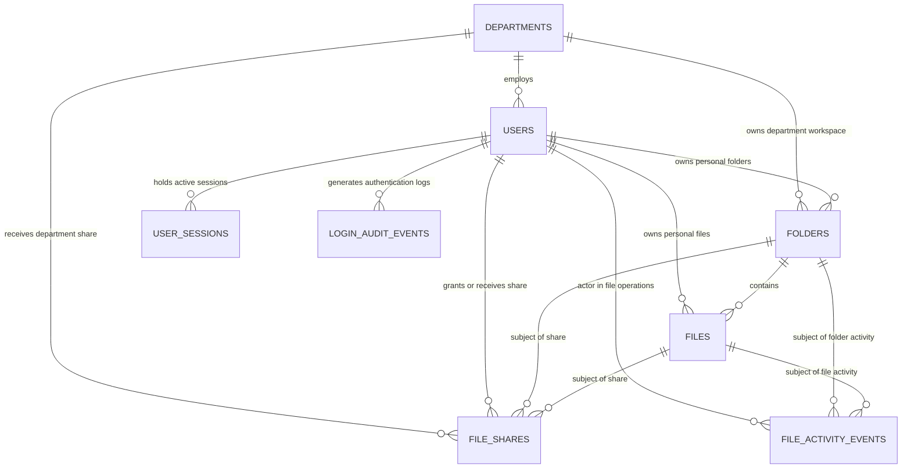
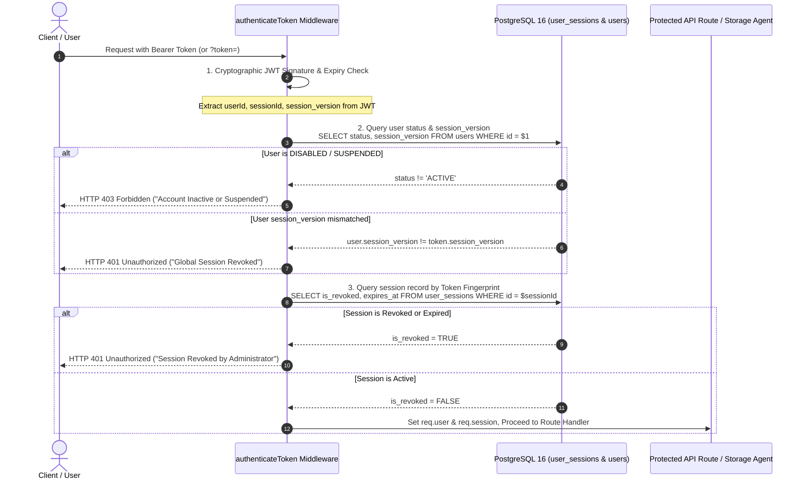

# NKB CLOUD v2.1.0 — CORRECTED ENTERPRISE ARCHITECTURE PLAN
## Enterprise My Drive, Department Sharing, RBAC & Security Audit Subsystem

**Document Version:** 2.1.0-CORRECTED  
**Author:** NKB Cloud Core Architecture Team  
**Review Mode:** Strict Read-Only Validation (Zero Code / Schema / File Modifications Applied)  
**Target Environment:** Local Offline Staging (Windows 11 Loopback `127.0.0.1`, PostgreSQL 16 on Port 5433)  
**Baseline Anchor:** `60057167ae0791b362adcecbb42ef335e8c120f8`  
**Current Branch:** `test/local-offline-env` (Commit `796c7fd`)  
**Status:** **READY FOR ADMINISTRATOR APPROVAL**

---

## 1. Correct Migration Numbering & Registry Analysis

### 1.1 Existing Migration Inventory
An inspection of `server/db/migrations/` and the live PostgreSQL `schema_migrations` table reveals six applied migrations:

| Version | Migration Filename | Scope / Purpose | Registry Status |
|---|---|---|---|
| **001** | `001_initial_schema.sql` | Baseline 20 physical tables (Users, Roles, Storage, Files) | Applied |
| **002** | `002_v2.1.0_identity_security_dlp.sql` | Composite physical drive identity & DLP test suite (13 tables) | Applied |
| **003** | `003_add_missing_stage1_tables.sql` | Added `storage_mount_history`, `storage_health_logs`, `agent_heartbeats` | Applied |
| **004** | `004_audit_log_protection.sql` | Cryptographic SHA-256 hash chaining & append-only trigger | Applied |
| **005** | `005_audit_chain_concurrency_and_privilege_hardening.sql` | Row-level locking on `audit_chain_head` & `nkb_app` privilege hardening | Applied |
| **006** | `006_stage2_security_hardening.sql` | Asymmetric Ed25519 agent credentials & nonces | Applied |

### 1.2 Identified Next Version: `007`
- **Correction Applied**: The initial proposal suggested reusing `005`. This has been corrected. The next sequential, collision-free migration identifier is strictly **`007`**.
- **Designated Files**:
  - Migration Script: `server/db/migrations/007_enterprise_departments_sharing_audit.sql`
  - Rollback Script: `server/db/migrations/007_enterprise_departments_sharing_audit_rollback.sql`
- **Compatibility Guarantees**:
  - Non-destructive execution within an atomic transaction (`BEGIN ... COMMIT`).
  - Strict preservation of all 39 existing tables, triggers, and foreign keys.
  - Zero disruption to `schema_migrations` audit sequence.

---

## 2. Corrected Database Schema Proposal

The corrected schema introduces normalized entities for departmental collaboration, session lifecycle, and granular security auditing while keeping existing structures intact.



### 2.1 Table Alterations & Enhancements
1. **`users` Table**:
   - `session_version INT DEFAULT 1 NOT NULL`: Incremented on account deactivation, password reset, or global session revocation to invalidate outstanding JWTs across all devices.
   - `is_department_head BOOLEAN DEFAULT FALSE NOT NULL`: Designates administrative leadership within the user's assigned department.
2. **`departments` Table**:
   - `is_active BOOLEAN DEFAULT TRUE NOT NULL`: Controls whether department is active or archived.
   - `manager_user_id UUID REFERENCES users(id)`: Explicit pointer to department head.
   - `created_at TIMESTAMPTZ DEFAULT CURRENT_TIMESTAMP`, `updated_at TIMESTAMPTZ DEFAULT CURRENT_TIMESTAMP`.
3. **`folders` & `files` Tables**:
   - `is_department_root BOOLEAN DEFAULT FALSE NOT NULL`: Distinguishes official department shared root workspaces from personal folders.
   - `is_quarantined BOOLEAN DEFAULT FALSE NOT NULL`: Hides test fixtures or policy-violating items from user views pending administrative review.
   - `is_test_data BOOLEAN DEFAULT FALSE NOT NULL`: Explicitly flags automated test artifacts without deleting them.

### 2.2 New Normalized Security & Audit Entities

#### A. Active Session Management (`user_sessions`)
```sql
CREATE TABLE user_sessions (
    id UUID PRIMARY KEY DEFAULT gen_random_uuid(),
    user_id UUID NOT NULL REFERENCES users(id) ON DELETE RESTRICT,
    token_fingerprint VARCHAR(64) NOT NULL UNIQUE, -- SHA-256 hash of token (NEVER plaintext)
    ip_address VARCHAR(45) NOT NULL,
    user_agent TEXT,
    device_type VARCHAR(50),
    os_name VARCHAR(50),
    browser_name VARCHAR(50),
    approx_location VARCHAR(100) DEFAULT 'Local Offline Staging',
    is_revoked BOOLEAN DEFAULT FALSE NOT NULL,
    revoked_at TIMESTAMPTZ,
    revoked_reason VARCHAR(100),
    expires_at TIMESTAMPTZ NOT NULL,
    created_at TIMESTAMPTZ DEFAULT CURRENT_TIMESTAMP NOT NULL,
    last_activity_at TIMESTAMPTZ DEFAULT CURRENT_TIMESTAMP NOT NULL
);
CREATE INDEX idx_user_sessions_lookup ON user_sessions(user_id, is_revoked);
CREATE INDEX idx_user_sessions_fingerprint ON user_sessions(token_fingerprint);
```

#### B. Dedicated Login Security Audit (`login_audit_events`)
```sql
CREATE TABLE login_audit_events (
    id BIGSERIAL PRIMARY KEY,
    user_id UUID REFERENCES users(id) ON DELETE SET NULL,
    username_attempted VARCHAR(100) NOT NULL,
    department_id INT REFERENCES departments(id) ON DELETE SET NULL,
    event_type VARCHAR(50) NOT NULL, -- 'LOGIN_SUCCESS', 'LOGIN_FAILED', 'LOGOUT', 'PASSWORD_CHANGE', 'SESSION_REVOKED', 'ACCOUNT_DISABLED', 'ACCOUNT_REACTIVATED'
    failure_reason VARCHAR(100), -- 'INVALID_PASSWORD', 'ACCOUNT_SUSPENDED', 'USER_NOT_FOUND', 'SESSION_EXPIRED', 'REVOKED'
    ip_address VARCHAR(45) NOT NULL,
    device_type VARCHAR(50),
    os_name VARCHAR(50),
    browser_name VARCHAR(50),
    user_agent TEXT,
    approx_location VARCHAR(100) DEFAULT 'Local Offline Staging (Windows 11)',
    session_id UUID REFERENCES user_sessions(id) ON DELETE SET NULL,
    previous_hash VARCHAR(64) DEFAULT '0000000000000000000000000000000000000000000000000000000000000000',
    record_hash VARCHAR(64),
    created_at TIMESTAMPTZ DEFAULT CURRENT_TIMESTAMP NOT NULL
);
CREATE INDEX idx_login_audit_user ON login_audit_events(user_id, created_at DESC);
CREATE INDEX idx_login_audit_event ON login_audit_events(event_type, created_at DESC);
```

#### C. Dedicated Granular File Activity Audit (`file_activity_events`)
```sql
CREATE TABLE file_activity_events (
    id BIGSERIAL PRIMARY KEY,
    actor_user_id UUID NOT NULL REFERENCES users(id) ON DELETE RESTRICT,
    department_id INT REFERENCES departments(id) ON DELETE SET NULL,
    action VARCHAR(50) NOT NULL, -- 'FOLDER_OPENED', 'FILE_PREVIEWED', 'FILE_DOWNLOADED', 'FILE_UPLOADED', 'FOLDER_CREATED', 'FILE_RENAMED', 'FILE_MOVED', 'FILE_TRASHED', 'FILE_RESTORED', 'FOLDER_SHARED', 'SHARE_REVOKED', 'ACCESS_DENIED'
    entity_type VARCHAR(20) NOT NULL, -- 'FILE', 'FOLDER'
    entity_id UUID NOT NULL,
    target_name VARCHAR(255) NOT NULL,
    source_ip VARCHAR(45) NOT NULL,
    device_browser VARCHAR(150),
    result VARCHAR(20) NOT NULL DEFAULT 'SUCCESS', -- 'SUCCESS', 'DENIED', 'FAILED'
    share_id UUID REFERENCES file_shares(id) ON DELETE SET NULL,
    correlation_id VARCHAR(64),
    details JSONB,
    previous_hash VARCHAR(64) DEFAULT '0000000000000000000000000000000000000000000000000000000000000000',
    record_hash VARCHAR(64),
    created_at TIMESTAMPTZ DEFAULT CURRENT_TIMESTAMP NOT NULL
);
CREATE INDEX idx_file_activity_actor ON file_activity_events(actor_user_id, created_at DESC);
CREATE INDEX idx_file_activity_entity ON file_activity_events(entity_type, entity_id);
CREATE INDEX idx_file_activity_action ON file_activity_events(action, created_at DESC);
```

---

## 3. Strict Separation of RBAC & Folder Sharing Architecture

To prevent privilege escalation where an ordinary folder share accidentally grants administrative privileges, the system architecture establishes four distinct, decoupled authorization layers:

```
+-----------------------------------------------------------------------------------+
| LAYER 1: SYSTEM ROLES (Global platform authority defined in roles table)           |
| -> SUPER ADMIN (universal root access, system settings, raw storage administration)|
| -> ADMIN (department user management, physical disk observation)                  |
| -> STANDARD USER (personal drive, standard departmental sharing)                   |
| -> VIEWER (read-only previews)                                                    |
+-----------------------------------------------------------------------------------+
                                        |
+-----------------------------------------------------------------------------------+
| LAYER 2: DEPARTMENT SCOPE (Membership in departments table)                       |
| -> Department Assignment: User belongs to exactly one primary department.          |
| -> Department Manager Flag: Can manage department members & approve dept folders.  |
| -> CANNOT override System Administrator rules; CANNOT access other departments.   |
+-----------------------------------------------------------------------------------+
                                        |
+-----------------------------------------------------------------------------------+
| LAYER 3: FOLDER WORKSPACE SCOPE (Logical boundaries in folders table)             |
| -> My Drive (personal, owner_id = user.id)                                        |
| -> Department Shared Folder (official departmental shared workspace)              |
| -> Shared with Me (explicit user-to-user or user-to-dept external grants)         |
+-----------------------------------------------------------------------------------+
                                        |
+-----------------------------------------------------------------------------------+
| LAYER 4: FOLDER SHARING GRANTS (Granular entries in file_shares table)             |
| ONLY ALLOWS:                                                                      |
| - VIEWER: List folder contents and preview supported text/image/pdf files.        |
| - DOWNLOADER: Viewer privileges + binary chunked streaming file download.         |
| - CONTRIBUTOR: Downloader privileges + upload files & create child directories.   |
| - EDITOR: Contributor privileges + rename and edit file metadata in that folder.  |
| STRICT ENFORCEMENT: 'ADMINISTRATOR' & 'DEPARTMENT_MANAGER' ARE NEVER PERMITTED AS  |
| SHARE PERMISSION LEVELS IN file_shares.                                           |
+-----------------------------------------------------------------------------------+
```

### Permission Matrix & Enforcement Hierarchy

| Operation | System SUPER ADMIN | Department Manager | Shared Folder EDITOR | Shared Folder CONTRIBUTOR | Shared Folder DOWNLOADER | Shared Folder VIEWER | Unauthorized User |
|---|:---:|:---:|:---:|:---:|:---:|:---:|:---:|
| **List Folder Items** | Yes | Yes (Dept Only) | Yes | Yes | Yes | Yes | **403 Denied** |
| **Preview Supported Files** | Yes | Yes (Dept Only) | Yes | Yes | Yes | Yes | **403 Denied** |
| **Download Files** | Yes | Yes (Dept Only) | Yes | Yes | Yes | **No** | **403 Denied** |
| **Upload Files** | Yes | Yes (Dept Only) | Yes | Yes | **No** | **No** | **403 Denied** |
| **Create Child Folders** | Yes | Yes (Dept Only) | Yes | Yes | **No** | **No** | **403 Denied** |
| **Rename / Move Files** | Yes | Yes (Dept Only) | Yes | **No** | **No** | **No** | **403 Denied** |
| **Share Folder** | Yes | Yes (Dept Only) | Yes | **No** | **No** | **No** | **403 Denied** |
| **Manage Dept Members** | Yes | Yes (Dept Only) | **No** | **No** | **No** | **No** | **403 Denied** |
| **Access Raw Storage Hardware**| Yes | **No** | **No** | **No** | **No** | **No** | **403 Denied** |

---

## 4. Audit Integrity & Cryptographic Hash Chain Architecture

To maintain tamper-evidence across all auditing streams without introducing concurrency bottlenecks or deadlock risks:

### 4.1 Tri-Stream Cryptographic Tracking
Migration 005 established a transaction-safe row-level lock on `system_settings` for the primary audit chain (`audit_chain_head`). We extend this proven pattern to login and file activity events:

1. `system_settings` Key: `audit_chain_head` -> Primary administrative & storage audit chain.
2. `system_settings` Key: `login_audit_chain_head` -> Dedicated login, authentication, and session security chain.
3. `system_settings` Key: `file_activity_chain_head` -> Dedicated file access, preview, download, and sharing chain.

### 4.2 Append-Only & Immutability Rules
Every event table (`audit_logs`, `login_audit_events`, `file_activity_events`) is protected by:
1. **Mutation Prevention Triggers**:
   `BEFORE UPDATE OR DELETE` triggers throw an explicit SQL exception:
   `NKB Cloud Security Policy: Audit records are strictly append-only. Modification and deletion are prohibited.`
2. **Fixed `search_path` Security**:
   All trigger functions are explicitly compiled with `SET search_path = public, pg_temp` to eliminate privilege hijacking vectors.
3. **Privilege Revocation on Database Role**:
   `REVOKE UPDATE, DELETE, TRUNCATE, TRIGGER ON login_audit_events, file_activity_events FROM nkb_app;`
   `GRANT SELECT, INSERT ON login_audit_events, file_activity_events TO nkb_app;`
   Ownership of all audit tables and triggers remains strictly with `postgres`. Normal application connections cannot drop, bypass, or alter triggers.

---

## 5. Airtight Session Revocation Design

### 5.1 The Two-Tier Revocation Mechanism
Authentication must never allow revoked sessions or disabled accounts to perform operations during JWT lifetime windows.



### 5.2 Token Storage Safety
- **Zero Plaintext Token Storage**: Plaintext JWTs are never written to the database.
- `user_sessions.token_fingerprint` stores `encode(digest(token, 'sha256'), 'hex')`.
- Session revocation can be performed:
  - **Individually**: By marking `is_revoked = TRUE` on a specific `user_sessions` row (e.g., logging out from a specific browser).
  - **Globally**: By incrementing `users.session_version = session_version + 1`, instantly invalidating every active token held by that user across all devices with zero database lock contention.

---

## 6. Safe Test-Data Quarantine Plan

### 6.1 Artifact Classification Matrix

| Item Identifier | Storage Location | Type / Classification | Owner / Association | Action Under Quarantine Plan |
|---|---|---|---|---|
| `Offline_Test_Folder` (10 rows) | PostgreSQL `folders` table | Confirmed Test Database Record | Super Admin (`...000000000001`) | Set `is_quarantined = TRUE`, `is_test_data = TRUE` |
| `Subfolder_Alpha` (10 rows) | PostgreSQL `folders` table | Confirmed Test Database Record | Super Admin (`...000000000001`) | Set `is_quarantined = TRUE`, `is_test_data = TRUE` |
| `NKB-Production-Drawing-2026.dwg` | `server/data/nkb_cloud_db.json` | Embedded Test Fallback Record | Local Fallback Store | Quarantine in JSON file archive |
| `dummy_100MB.bin` | `C:\NKB-Cloud-Offline-Test\Storage\test_uploads` | Confirmed Test Binary Artifact | Test Harness | Keep on disk; mark quarantined in DB |
| `dummy_10MB.bin` | `C:\NKB-Cloud-Offline-Test\Storage\test_uploads` | Confirmed Test Binary Artifact | Test Harness | Keep on disk; mark quarantined in DB |
| `dummy_500MB.bin` | `C:\NKB-Cloud-Offline-Test\Storage\test_uploads` | Confirmed Test Binary Artifact | Test Harness | Keep on disk; mark quarantined in DB |
| `dummy_document.pdf` | `C:\NKB-Cloud-Offline-Test\Storage\test_uploads` | Confirmed Test Binary Artifact | Test Harness | Keep on disk; mark quarantined in DB |
| `dummy_image.png` | `C:\NKB-Cloud-Offline-Test\Storage\test_uploads` | Confirmed Test Binary Artifact | Test Harness | Keep on disk; mark quarantined in DB |
| `dummy_sample.txt` | `C:\NKB-Cloud-Offline-Test\Storage\test_uploads` | Confirmed Test Binary Artifact | Test Harness | Keep on disk; mark quarantined in DB |
| `interrupted_test.bin` | `C:\NKB-Cloud-Offline-Test\Storage\test_uploads` | Confirmed Test Binary Artifact | Test Harness | Keep on disk; mark quarantined in DB |
| `Admin Office`, `IT STAFF`, `Inventory`, etc. | Physical Storage (`J:`, `D:`, `G:`) | Actual Company Folders & Files | Real Corporate Data | **100% UNTOUCHED (IMMUTABLE)** |

### 6.2 Database-Level Quarantine Execution (Non-Destructive)
1. **Pre-Quarantine Database Dump**:
   Before updating records, execute a complete PostgreSQL backup:
   `pg_dump -Fc -h 127.0.0.1 -p 5433 -U postgres nkb_cloud_local_test > C:\NKB-Cloud-Offline-Test\Logs\pre_enterprise_quarantine_backup.dump`
2. **Database Update in Migration `007`**:
   ```sql
   UPDATE folders
   SET is_quarantined = TRUE, is_test_data = TRUE, updated_at = CURRENT_TIMESTAMP
   WHERE name IN ('Offline_Test_Folder', 'Subfolder_Alpha');
   ```
3. **Application Query Hardening (`fileController.js`)**:
   All explorer, file list, and search queries must enforce:
   `WHERE is_trashed = FALSE AND is_quarantined = FALSE AND is_test_data = FALSE`
4. **Physical File Policy**:
   - Zero physical files on disk (`C:\NKB-Cloud-Offline-Test\Storage\test_uploads`) will be deleted or moved during this phase.
   - Any physical file cleanup will remain isolated for a separate future authorization drill.

---

## 7. Data Preservation Assessment

An audit of existing production and staging assets confirms that the following critical entities exist and will be strictly preserved:

1. **Storage Device & Volume Identity**:
   - `storage_devices` records for NVMe (`KBG50ZNS512G`), SATA SSD (`ST1000LM049-2GH172`), and external USB drives (`GeIL Z3_ 512GB`).
   - `storage_volumes` records for volumes `J:`, `D:`, `G:` with composite hardware fingerprints (`serial`, `uuid`, `offset`).
   - `storage_agents` and `agent_credentials` holding active Ed25519 pairing records.
2. **Physical Filesystem Integrity**:
   - Enterprise corporate folders on `J:` (`Admin Office`, `Executive`, `Inventory`, `IT STAFF`, `Marketing`, `Regulatory`, `TikTok`).
   - Corporate archives on `D:` (`Downloads`, `Formulation Manager`, `Inventory`, `XAMPP`).
   - Zero physical drive writes or file deletions will occur.
3. **Administrative Account & Existing Audit History**:
   - Default Super Admin account (`00000000-0000-0000-0000-000000000001`, `admin@nkbmanufacturing.com`) preserved.
   - All 70 existing rows in `audit_logs` (including drive scan records and audit hash chain heads) remain unaltered.

---

## 8. Dependency & Compatibility Risk Analysis

| Risk ID | Identified Risk | Severity | Mitigation Strategy |
|---|---|:---:|---|
| **RISK-01** | Migration numbering collision with historical Stage 2 hardening scripts (`005`, `006`). | Critical | **Resolved**: Numbering updated to `007`. Full compatibility verification with `schema_migrations`. |
| **RISK-02** | Accidental escalation of folder share recipient to system administrator. | High | **Resolved**: Layer 4 sharing grants strictly limited to `VIEWER`, `DOWNLOADER`, `CONTRIBUTOR`, `EDITOR`. Roles `ADMIN` and `DEPARTMENT_MANAGER` restricted to Layers 1 & 2. |
| **RISK-03** | Database lock contention on concurrent audit log inserts under multi-user activity. | Medium | **Resolved**: Segregated row-level locking heads (`login_audit_chain_head`, `file_activity_chain_head`) ensure login and file operations serialize independently without bottlenecking general system audits. |
| **RISK-04** | Stale JWT permissions when an employee moves between departments or has their account disabled. | High | **Resolved**: Real-time `session_version` and status verification in `authenticateToken` on every request. |
| **RISK-05** | Accidental permanent deletion of physical company files. | Critical | **Resolved**: My Drive operations map only to authorized logical folders. Volume Browser remains read-only. Physical deletions are impossible through the API. |

---

## 9. Ordered Implementation Milestones

Upon administrator authorization, the implementation will proceed in seven controlled, sequential phases:

```
[Phase 1: Database Backup & Versioned Migration 007]
  - Create full pg_dump backup: pre_enterprise_quarantine_backup.dump
  - Apply 007_enterprise_departments_sharing_audit.sql
  - Execute non-destructive quarantine on 20 test folders
  - Verify schema_migrations contains 001 through 007

[Phase 2: Authentication & Session Revocation Subsystem]
  - Update authController.js: Issue token with session_version & sessionId; insert user_sessions & login_audit_events
  - Update middleware/auth.js: Enforce status != 'ACTIVE', session_version matching, and token fingerprint verification
  - Implement POST /api/auth/logout and POST /api/admin/users/:id/revoke-sessions

[Phase 3: Department Management Subsystem]
  - Implement full Department CRUD: GET, POST, PUT, DELETE /api/admin/departments
  - Enforce department assignment in user creation and editing
  - Ensure department changes trigger immediate session_version increment and access recalculation

[Phase 4: Folder Sharing & Granular RBAC Engine]
  - Implement enterprise sharing in shareController.js:
    - User-to-user and user-to-department shares
    - VIEWER, DOWNLOADER, CONTRIBUTOR, EDITOR permissions
    - Optional expiration date and sharing note
  - Implement recursive permission inheritance for child folders and files
  - Log all file activities in file_activity_events

[Phase 5: Clean My Drive, Shared With Me & Department Workspaces]
  - Update fileController.js:
    - My Drive: Only show unquarantined personal content owned by the user
    - Shared With Me: Return folders and files shared directly with user or user's department
    - Department Shared Folders: Return official department workspaces
    - Trash: Permission-controlled soft deletion and restoration

[Phase 6: Frontend Enterprise UI Components]
  - Update Sidebar.jsx: Add Department Shared Folders, Department Management, Security & Activity Logs
  - Update FileManagerView.jsx: Support Department Shared Folders view, clean My Drive view, and permission badges
  - Create SecurityAuditDashboard.jsx: Tabs for Login Security Audit, File Activity Audit, and Sharing Activity Audit
  - Enhance ShareModal.jsx: Department selection, expiration date picker, sharing notes, and permission dropdown

[Phase 7: Comprehensive 15-Scenario Verification Drill]
  - Execute automated end-to-end test suite: server/test-enterprise-departments-suite.js
  - Verify all 15 scenarios: Clean My Drive, HR creation, folder sharing, cross-department boundary enforcement, immediate revocation, and tamper-resistant audit logs
  - Generate all 7 required documentation deliverables in docs/
```

---

## 10. Final Architectural Determination

- [x] **READY FOR ADMINISTRATOR APPROVAL**
- [ ] **NOT READY — ADDITIONAL DESIGN REQUIRED**

**Reasoning**: All seven pre-implementation corrections have been rigorously addressed. The migration numbering is resolved to `007`, test artifacts are safely quarantined at the database level without moving physical files, RBAC layers are decoupled to eliminate privilege escalation, audit streams are hardened with independent concurrency locks and append-only triggers, and session revocation is enforced on every protected request.

**Standing Instructions**: System remains in **Strict Read-Only Mode**. No database modifications, migrations, or file alterations will occur until explicit administrator authorization is received.
