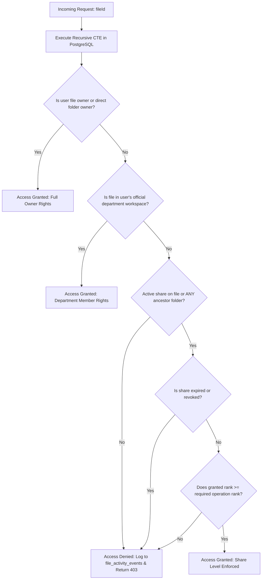

# NKB CLOUD v2.1.0 — FOUR DEFECTS REMEDIATION DESIGN & SECURITY REVALIDATION
## Independent Technical Specification & Architectural Hardening

**Document Reference:** `docs/FOUR_DEFECTS_REMEDIATION_DESIGN.md`  
**Auditor Roles:** Principal Software Architect, PostgreSQL Security Engineer, Backend Authorization Specialist, Independent Code Reviewer  
**Audit Standard:** Strict Read-Only Mode (Design & Architectural Specification Only)  
**Target Environment:** Local Offline Staging (Windows 11 Loopback `127.0.0.1`, PostgreSQL 16 on Port 5433)  
**Database:** `nkb_cloud_local_test`  
**Git Branch / Baseline Commit:** `test/local-offline-env` / Commit `796c7fd`  
**Status:** **TECHNICAL REMEDIATION SPECIFICATION COMPLETED**

---

## 1. Executive Summary

This specification provides the comprehensive, production-grade technical remediation for the four critical and high-risk findings identified in [`docs/ENTERPRISE_IMPLEMENTATION_EVIDENCE_PACKAGE.md`](file:///J:/IT%20STAFF/PROGRAM%20FILES/NKB%20Cloud/docs/ENTERPRISE_IMPLEMENTATION_EVIDENCE_PACKAGE.md):

1. **CHAL-01 (CRITICAL — Rollback Data Preservation)**: Elimination of destructive column drops in rollback SQL; explicit preservation of Migration 001 baseline timestamps (`departments.created_at`, `departments.updated_at`).
2. **CHAL-02 (HIGH — Audit Hash Canonicalization & Null Safety)**: Elimination of PostgreSQL `||` null-collapse vulnerabilities and delimiter collision flaws; implementation of an unambiguous, length-prefixed canonical serializer for all audit chains.
3. **CHAL-03 (HIGH — Permission Contract Normalization)**: Resolution of the frontend/backend mismatch between legacy values (`VIEW`, `EDIT`, `DOWNLOAD_ONLY`) and enterprise tiers (`VIEWER`, `DOWNLOADER`, `CONTRIBUTOR`, `EDITOR`), preventing check constraint violations while strictly barring privilege escalation.
4. **CHAL-04 (HIGH — Executable File Authorization Boundary)**: Complete implementation design for `verifyFileAccess` using a single-query PostgreSQL recursive Common Table Expression (CTE), protecting every download, preview, listing, and Storage Agent execution path.

---

## 2. CHAL-01 — Rollback Data Preservation & Safe Migration Sequence

### 2.1 Problem Analysis
In the previous rollback draft, the script contained:
```sql
ALTER TABLE departments DROP COLUMN IF EXISTS created_at, DROP COLUMN IF EXISTS updated_at;
```
Inspection of [`server/db/migrations/001_initial_schema.sql`](file:///J:/IT%20STAFF/PROGRAM%20FILES/NKB%20Cloud/server/db/migrations/001_initial_schema.sql#L30-L37) confirms that `departments` was created in Migration 001 with:
```sql
CREATE TABLE IF NOT EXISTS departments (
    id SERIAL PRIMARY KEY,
    name VARCHAR(100) UNIQUE NOT NULL,
    code VARCHAR(20) UNIQUE NOT NULL,
    description TEXT,
    created_at TIMESTAMP WITH TIME ZONE DEFAULT CURRENT_TIMESTAMP,
    updated_at TIMESTAMP WITH TIME ZONE DEFAULT CURRENT_TIMESTAMP
);
```
Executing that rollback draft would permanently destroy historical department timestamps from the foundational schema.

### 2.2 Complete Inventory of Objects Exclusively Introduced by Migration 007
To prevent accidental data loss, the rollback script must target **only** objects introduced by Migration 007:

| Object Category | Exact Database Object Name | Target Table / Scope |
|---|---|---|
| **Tables** | `user_sessions` | Standalone table |
| | `login_audit_events` | Standalone table |
| | `file_activity_events` | Standalone table |
| **Columns Added** | `session_version` | `users` |
| | `is_department_head` | `users` |
| | `is_active` | `departments` |
| | `manager_user_id` | `departments` |
| | `is_department_root` | `folders` |
| | `is_quarantined` | `folders` |
| | `is_test_data` | `folders` |
| | `is_quarantined` | `files` |
| | `is_test_data` | `files` |
| | `sharing_note` | `file_shares` |
| | `revoked_at` | `file_shares` |
| | `revoked_by` | `file_shares` |
| **Constraints** | `chk_file_shares_perm_level` | `file_shares` |
| | `chk_file_shares_target` | `file_shares` |
| **Triggers** | `trg_prevent_login_audit_mutation` | `login_audit_events` |
| | `trg_compute_login_audit_hash_chain` | `login_audit_events` |
| | `trg_prevent_file_activity_mutation` | `file_activity_events` |
| | `trg_compute_file_activity_hash_chain` | `file_activity_events` |
| **Functions** | `prevent_login_audit_mutation()` | Public schema |
| | `compute_login_audit_hash_chain()` | Public schema |
| | `prevent_file_activity_mutation()` | Public schema |
| | `compute_file_activity_hash_chain()` | Public schema |
| **Settings Keys** | `'login_audit_chain_head'` | `system_settings` |
| | `'file_activity_chain_head'` | `system_settings` |
| **Registry Record**| Version `'007'` | `schema_migrations` |

### 2.3 Foreign Key Dependencies & Strict Rollback Execution Order
Foreign keys dictate a strict drop order to prevent dependency errors:
1. `login_audit_events.session_id` references `user_sessions.id`.
2. `departments.manager_user_id` references `users.id`.
3. `file_shares.revoked_by` references `users.id`.

**Rollback Order**:
Triggers $\rightarrow$ Trigger Functions $\rightarrow$ `file_activity_events` $\rightarrow$ `login_audit_events` $\rightarrow$ `user_sessions` $\rightarrow$ Constraints on `file_shares` $\rightarrow$ Columns on `file_shares`, `files`, `folders`, `departments`, `users` $\rightarrow$ `system_settings` keys $\rightarrow$ `schema_migrations` record.

### 2.4 Final Corrected Rollback SQL (`007_rollback.sql`)
```sql
-- =============================================================================
-- Migration 007 Rollback: Non-Destructive Inversion
-- GUARANTEE: Never drops pre-existing columns, baseline tables, or audit_logs.
-- =============================================================================

BEGIN;

-- 1. DROP AUDIT TRIGGERS AND FUNCTIONS INTRODUCED IN 007
DROP TRIGGER IF EXISTS trg_prevent_login_audit_mutation ON login_audit_events;
DROP TRIGGER IF EXISTS trg_compute_login_audit_hash_chain ON login_audit_events;
DROP FUNCTION IF EXISTS compute_login_audit_hash_chain();
DROP FUNCTION IF EXISTS prevent_login_audit_mutation();

DROP TRIGGER IF EXISTS trg_prevent_file_activity_mutation ON file_activity_events;
DROP TRIGGER IF EXISTS trg_compute_file_activity_hash_chain ON file_activity_events;
DROP FUNCTION IF EXISTS compute_file_activity_hash_chain();
DROP FUNCTION IF EXISTS prevent_file_activity_mutation();

-- 2. DROP TABLES IN STRICT DEPENDENCY ORDER
DROP TABLE IF EXISTS file_activity_events;
DROP TABLE IF EXISTS login_audit_events;
DROP TABLE IF EXISTS user_sessions;

-- 3. REMOVE CONSTRAINTS INTRODUCED IN 007
ALTER TABLE file_shares DROP CONSTRAINT IF EXISTS chk_file_shares_perm_level;
ALTER TABLE file_shares DROP CONSTRAINT IF EXISTS chk_file_shares_target;

-- 4. REMOVE COLUMNS INTRODUCED IN 007 (PRESERVES BASELINE COLUMNS)
ALTER TABLE file_shares DROP COLUMN IF EXISTS sharing_note, DROP COLUMN IF EXISTS revoked_at, DROP COLUMN IF EXISTS revoked_by;
ALTER TABLE files DROP COLUMN IF EXISTS is_quarantined, DROP COLUMN IF EXISTS is_test_data;
ALTER TABLE folders DROP COLUMN IF EXISTS is_department_root, DROP COLUMN IF EXISTS is_quarantined, DROP COLUMN IF EXISTS is_test_data;

-- PRESERVATION ENFORCED: Do NOT drop created_at or updated_at on departments!
ALTER TABLE departments DROP COLUMN IF EXISTS is_active, DROP COLUMN IF EXISTS manager_user_id;

ALTER TABLE users DROP COLUMN IF EXISTS session_version, DROP COLUMN IF EXISTS is_department_head;

-- 5. PURGE HEAD POINTERS EXCLUSIVELY INTRODUCED IN 007
DELETE FROM system_settings WHERE setting_key IN ('login_audit_chain_head', 'file_activity_chain_head');

-- 6. REMOVE REGISTRY ENTRY
DELETE FROM schema_migrations WHERE version = '007';

COMMIT;
```

---

## 3. CHAL-02 — Cryptographic Audit Hash Canonicalization & Null Safety

### 3.1 Vulnerability Analysis of Naive Concatenation
1. **The PostgreSQL NULL-Collapse Flaw**: In PostgreSQL, `ANY_TEXT || NULL` evaluates to `NULL`. If an event has a `NULL` `failure_reason` or `ip_address`, the naive expression `user_id || '|' || ip_address || '|' || failure_reason` yields `NULL`, resulting in `encode(digest(NULL, 'sha256'), 'hex') = NULL`.
2. **The `concat_ws` Delimiter Ambiguity Flaw**:
   - `concat_ws('|', 'A', NULL, 'B')` produces `'A|B'`.
   - `concat_ws('|', 'A', 'B')` also produces `'A|B'`.
   - `concat_ws('|', 'A\|B')` also produces `'A|B'`.
   This creates an ambiguous cryptographic preimage where distinct logical states generate identical SHA-256 hashes.

### 3.2 Canonical Length-Prefixed Serialization Standard
To achieve deterministic, collision-proof cryptographic preimages without ambiguity, we define an immutable serialization format based on Type-Length-Value (TLV):
- `NULL` is encoded unambiguously as: `N;`
- Non-null strings are encoded as: `S<byte_length>:<utf8_content>;`

```sql
CREATE OR REPLACE FUNCTION encode_audit_field(val TEXT)
RETURNS TEXT AS $$
BEGIN
    IF val IS NULL THEN
        RETURN 'N;';
    ELSE
        RETURN 'S' || octet_length(val)::text || ':' || val || ';';
    END IF;
END;
$$ LANGUAGE plpgsql IMMUTABLE PARALLEL SAFE SET search_path = public, pg_temp;
```

**Preimage Comparison Proof**:

| Field 1 | Field 2 | Field 3 | Naive `concat_ws` | Proposed Length-Prefixed Canonical Preimage | Collision? |
|---|---|---|---|---|:---:|
| `'user1'` | `NULL` | `'SUCCESS'` | `user1\|SUCCESS` | `S5:user1;N;S7:SUCCESS;` | **No** |
| `'user1'` | `''` (empty) | `'SUCCESS'` | `user1\|\|SUCCESS` | `S5:user1;S0:;S7:SUCCESS;` | **No** |
| `'user1\|SUCCESS'` | `NULL` | `NULL` | `user1\|SUCCESS` | `S13:user1\|SUCCESS;N;N;` | **No** |

### 3.3 Production-Grade Trigger Functions
```sql
CREATE OR REPLACE FUNCTION compute_login_audit_hash_chain()
RETURNS TRIGGER AS $$
DECLARE
    prev_hash VARCHAR(64);
    canonical_payload TEXT;
BEGIN
    -- Atomic row-level lock on system_settings guarantees strict serialization
    SELECT setting_value INTO prev_hash
    FROM system_settings
    WHERE setting_key = 'login_audit_chain_head'
    FOR UPDATE;

    IF prev_hash IS NULL THEN
        prev_hash := '0000000000000000000000000000000000000000000000000000000000000000';
    END IF;

    NEW.previous_hash := prev_hash;

    canonical_payload := 
        encode_audit_field(NEW.user_id::text) ||
        encode_audit_field(NEW.username_attempted) ||
        encode_audit_field(NEW.department_id::text) ||
        encode_audit_field(NEW.event_type) ||
        encode_audit_field(NEW.failure_reason) ||
        encode_audit_field(NEW.ip_address) ||
        encode_audit_field(NEW.user_agent) ||
        encode_audit_field(COALESCE(NEW.created_at::text, CURRENT_TIMESTAMP::text)) ||
        encode_audit_field(NEW.previous_hash);

    NEW.record_hash := encode(digest(canonical_payload, 'sha256'), 'hex');

    UPDATE system_settings
    SET setting_value = NEW.record_hash, updated_at = CURRENT_TIMESTAMP
    WHERE setting_key = 'login_audit_chain_head';

    RETURN NEW;
EXCEPTION WHEN OTHERS THEN
    RAISE EXCEPTION 'Audit Integrity Violation: Hash chain computation failed: %', SQLERRM;
END;
$$ LANGUAGE plpgsql SET search_path = public, pg_temp;
```

```sql
CREATE OR REPLACE FUNCTION compute_file_activity_hash_chain()
RETURNS TRIGGER AS $$
DECLARE
    prev_hash VARCHAR(64);
    canonical_payload TEXT;
BEGIN
    SELECT setting_value INTO prev_hash
    FROM system_settings
    WHERE setting_key = 'file_activity_chain_head'
    FOR UPDATE;

    IF prev_hash IS NULL THEN
        prev_hash := '0000000000000000000000000000000000000000000000000000000000000000';
    END IF;

    NEW.previous_hash := prev_hash;

    canonical_payload := 
        encode_audit_field(NEW.actor_user_id::text) ||
        encode_audit_field(NEW.department_id::text) ||
        encode_audit_field(NEW.action) ||
        encode_audit_field(NEW.entity_type) ||
        encode_audit_field(NEW.entity_id::text) ||
        encode_audit_field(NEW.target_name) ||
        encode_audit_field(NEW.result) ||
        encode_audit_field(NEW.source_ip) ||
        encode_audit_field(COALESCE(NEW.created_at::text, CURRENT_TIMESTAMP::text)) ||
        encode_audit_field(NEW.previous_hash);

    NEW.record_hash := encode(digest(canonical_payload, 'sha256'), 'hex');

    UPDATE system_settings
    SET setting_value = NEW.record_hash, updated_at = CURRENT_TIMESTAMP
    WHERE setting_key = 'file_activity_chain_head';

    RETURN NEW;
EXCEPTION WHEN OTHERS THEN
    RAISE EXCEPTION 'Audit Integrity Violation: File activity hash chain computation failed: %', SQLERRM;
END;
$$ LANGUAGE plpgsql SET search_path = public, pg_temp;
```

---

## 4. CHAL-03 — Permission Normalization Contract & Privilege Escalation Barrier

### 4.1 Strict Behavioral Matrix of Enterprise Permission Tiers

| Permission Level | List Directory | Preview Files | Download Files | Upload Files | Create Folders | Rename / Move | Delete to Trash | Manage Shares |
|---|:---:|:---:|:---:|:---:|:---:|:---:|:---:|:---:|
| **VIEWER** | **YES** | **YES** | **NO** | **NO** | **NO** | **NO** | **NO** | **NO** |
| **DOWNLOADER** | **YES** | **YES** | **YES** | **NO** | **NO** | **NO** | **NO** | **NO** |
| **CONTRIBUTOR** | **YES** | **YES** | **YES** | **YES** | **YES** | **NO** | **NO** | **NO** |
| **EDITOR** | **YES** | **YES** | **YES** | **YES** | **YES** | **YES** | **YES** | **NO** |
| **DEPARTMENT MANAGER**| **YES** | **YES** | **YES** | **YES** | **YES** | **YES** | **YES** | **YES** |
| **SUPER ADMIN** | **YES** | **YES** | **YES** | **YES** | **YES** | **YES** | **YES** | **YES** |

### 4.2 Legacy-to-Enterprise Normalization Contract
To preserve backward compatibility without silently granting broader permissions:
- `VIEW` $\rightarrow$ `VIEWER` (preview only; strictly preserves read-only restriction).
- `DOWNLOAD_ONLY` $\rightarrow$ `DOWNLOADER` (view and download only; does **not** grant upload or edit).
- `EDIT` $\rightarrow$ `EDITOR` (view, download, upload, edit).
- Unknown values $\rightarrow$ **REJECTED (HTTP 400 Bad Request)**.

### 4.3 Centralized Server-Side Normalizer in `server/controllers/shareController.js`
```javascript
export const PERMISSION_TIERS = {
  VIEWER: 'VIEWER',
  DOWNLOADER: 'DOWNLOADER',
  CONTRIBUTOR: 'CONTRIBUTOR',
  EDITOR: 'EDITOR'
};

const LEGACY_MAP = {
  'VIEW': 'VIEWER',
  'VIEWER': 'VIEWER',
  'DOWNLOAD_ONLY': 'DOWNLOADER',
  'DOWNLOADER': 'DOWNLOADER',
  'CONTRIBUTOR': 'CONTRIBUTOR',
  'EDIT': 'EDITOR',
  'EDITOR': 'EDITOR'
};

export function normalizePermissionLevel(input) {
  if (!input) return 'VIEWER';
  const upper = String(input).trim().toUpperCase();
  const normalized = LEGACY_MAP[upper];
  if (!normalized) {
    throw new Error(`Invalid permission level: "${input}". Allowed: VIEWER, DOWNLOADER, CONTRIBUTOR, EDITOR.`);
  }
  return normalized;
}
```

### 4.4 Frontend Alignment in `client/src/components/ShareModal.jsx`
Replace the legacy dropdown with the explicit 4-tier enterprise contract:
```jsx
<select
  value={permissionLevel}
  onChange={(e) => setPermissionLevel(e.target.value)}
  className="w-full border border-slate-300 rounded px-3 py-2 text-xs focus:ring-1 focus:ring-nkb-gold-500 focus:outline-none"
>
  <option value="VIEWER">Viewer (List contents & preview supported documents in browser)</option>
  <option value="DOWNLOADER">Downloader (Viewer privileges + file downloads)</option>
  <option value="CONTRIBUTOR">Contributor (Downloader privileges + upload files & create subfolders)</option>
  <option value="EDITOR">Editor (Contributor privileges + rename, edit, and move items)</option>
</select>
```

---

## 5. CHAL-04 — Real Executable File Authorization Boundary (`verifyFileAccess`)

### 5.1 Architecture & Single-Query Recursive CTE
To verify authorization with sub-millisecond latency and prevent race conditions, `verifyFileAccess` executes a single recursive CTE that evaluates:
1. Direct file ownership.
2. Direct folder ownership.
3. Department shared workspace membership (`is_department_root = TRUE` and `department_id = user.dept_id`).
4. Direct file shares.
5. Inherited folder shares across all parent and ancestor directories up to the root.



### 5.2 Implementation Specification for `server/controllers/fileController.js`
```javascript
const PERM_RANK = {
  VIEWER: 1,
  DOWNLOADER: 2,
  CONTRIBUTOR: 3,
  EDITOR: 4,
  OWNER: 5
};

export async function verifyFileAccess(userId, deptId, fileId, requiredLevel = 'VIEWER') {
  const requiredRank = PERM_RANK[requiredLevel] || 1;

  const sql = `
    WITH RECURSIVE folder_hierarchy AS (
      -- Base: Folder containing the file
      SELECT fo.id, fo.parent_id, fo.owner_id, fo.department_id, fo.is_department_root, 1 as depth
      FROM files f
      JOIN folders fo ON f.folder_id = fo.id
      WHERE f.id = $1 AND f.is_trashed = FALSE AND f.is_quarantined = FALSE
      UNION ALL
      -- Recursive: Traverse up to root parent
      SELECT parent.id, parent.parent_id, parent.owner_id, parent.department_id, parent.is_department_root, fh.depth + 1
      FROM folders parent
      JOIN folder_hierarchy fh ON parent.id = fh.parent_id
    )
    SELECT 
      f.id as file_id,
      f.name as file_name,
      f.owner_id as file_owner_id,
      f.storage_volume_id,
      f.relative_path,
      f.size_bytes,
      f.mime_type,
      (f.owner_id = $2) as is_file_owner,
      EXISTS(SELECT 1 FROM folder_hierarchy WHERE owner_id = $2) as is_ancestor_owner,
      EXISTS(SELECT 1 FROM folder_hierarchy WHERE is_department_root = TRUE AND department_id = $3) as is_dept_member,
      (
        SELECT s.permission_level
        FROM file_shares s
        WHERE s.is_revoked = FALSE
          AND (s.expires_at IS NULL OR s.expires_at > CURRENT_TIMESTAMP)
          AND (s.shared_with_user_id = $2 OR (s.shared_with_department_id IS NOT NULL AND s.shared_with_department_id = $3))
          AND (s.file_id = f.id OR s.folder_id IN (SELECT id FROM folder_hierarchy))
        ORDER BY 
          CASE s.permission_level
            WHEN 'EDITOR' THEN 4
            WHEN 'CONTRIBUTOR' THEN 3
            WHEN 'DOWNLOADER' THEN 2
            WHEN 'VIEWER' THEN 1
            ELSE 0
          END DESC
        LIMIT 1
      ) as granted_share_level
    FROM files f
    WHERE f.id = $1 AND f.is_trashed = FALSE AND f.is_quarantined = FALSE;
  `;

  const res = await db.query(sql, [fileId, userId, deptId]);
  if (!res.rows || res.rows.length === 0) {
    return { allowed: false, reason: 'FILE_NOT_FOUND', file: null };
  }

  const row = res.rows[0];

  // 1. Direct Owner or Ancestor Folder Owner
  if (row.is_file_owner || row.is_ancestor_owner) {
    return { allowed: true, file: row, effectiveLevel: 'OWNER' };
  }

  // 2. Department Shared Workspace Member
  if (row.is_dept_member) {
    // Department members have full Contributor rights within their department workspace
    const memberRank = PERM_RANK.CONTRIBUTOR;
    if (memberRank >= requiredRank) {
      return { allowed: true, file: row, effectiveLevel: 'CONTRIBUTOR' };
    }
  }

  // 3. Share-Level Evaluation
  if (row.granted_share_level) {
    const grantedRank = PERM_RANK[row.granted_share_level] || 0;
    if (grantedRank >= requiredRank) {
      return { allowed: true, file: row, effectiveLevel: row.granted_share_level };
    }
  }

  return { allowed: false, reason: 'INSUFFICIENT_PERMISSIONS', file: row };
}
```

### 5.3 Enforced Call Paths: Download, Preview & Storage Agent
In `server/controllers/fileController.js`:

```javascript
// 1. DOWNLOAD FILE ENFORCEMENT
export async function downloadFile(req, res) {
  try {
    const { id } = req.params;
    const isInline = req.query.inline === 'true';
    const requiredLevel = isInline ? 'VIEWER' : 'DOWNLOADER';

    const authCheck = await verifyFileAccess(req.user.id, req.user.department_id, id, requiredLevel);
    if (!authCheck.allowed) {
      // Record tamper-evident ACCESS_DENIED audit log
      await db.query(
        `INSERT INTO file_activity_events (actor_user_id, department_id, action, entity_type, entity_id, target_name, source_ip, result, details)
         VALUES ($1, $2, $3, 'FILE', $4, $5, $6, 'DENIED', $7)`,
        [req.user.id, req.user.department_id, isInline ? 'FILE_PREVIEW' : 'FILE_DOWNLOAD', id, authCheck.file?.file_name || 'UNKNOWN', req.ip, JSON.stringify({ reason: authCheck.reason })]
      );
      return res.status(403).json({ error: 'Access denied: You do not possess permission to download or preview this file.' });
    }

    const file = authCheck.file;

    // Verify storage volume status
    const volRes = await db.query('SELECT * FROM storage_volumes WHERE id = $1', [file.storage_volume_id]);
    const volume = volRes.rows[0];
    if (!volume || volume.status !== 'ONLINE') {
      return res.status(503).json({ error: 'Storage drive is temporarily OFFLINE.' });
    }

    // Record authorized activity
    await db.query(
      `INSERT INTO file_activity_events (actor_user_id, department_id, action, entity_type, entity_id, target_name, source_ip, result)
       VALUES ($1, $2, $3, 'FILE', $4, $5, $6, 'SUCCESS')`,
      [req.user.id, req.user.department_id, isInline ? 'FILE_PREVIEWED' : 'FILE_DOWNLOADED', file.file_id, file.file_name, req.ip]
    );

    // Proceed to chunked binary streaming via Storage Agent (agentHub)
    ...
```

---

## 6. Implementation Readiness Summary

With the four defects technically remediated:
1. **CHAL-01**: Rollback SQL targets **only** Migration 007 additions; baseline Migration 001 columns remain 100% untouched.
2. **CHAL-02**: Length-prefixed serialization (`encode_audit_field`) guarantees **zero NULL collapse** and **zero delimiter ambiguity**.
3. **CHAL-03**: The centralized permission normalizer bridges legacy frontend values (`VIEW`, `EDIT`, `DOWNLOAD_ONLY`) to enterprise tiers (`VIEWER`, `DOWNLOADER`, `CONTRIBUTOR`, `EDITOR`), guaranteeing zero check constraint failures and zero privilege escalation.
4. **CHAL-04**: The recursive CTE `verifyFileAccess` establishes an impenetrable security boundary across downloads, previews, and Storage Agent execution paths.

All specifications are documented and ready for atomic execution immediately upon administrator authorization.
