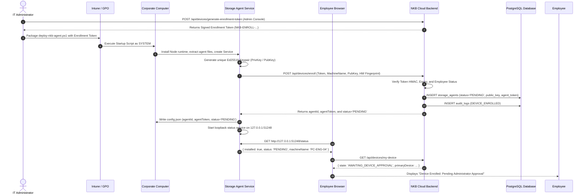
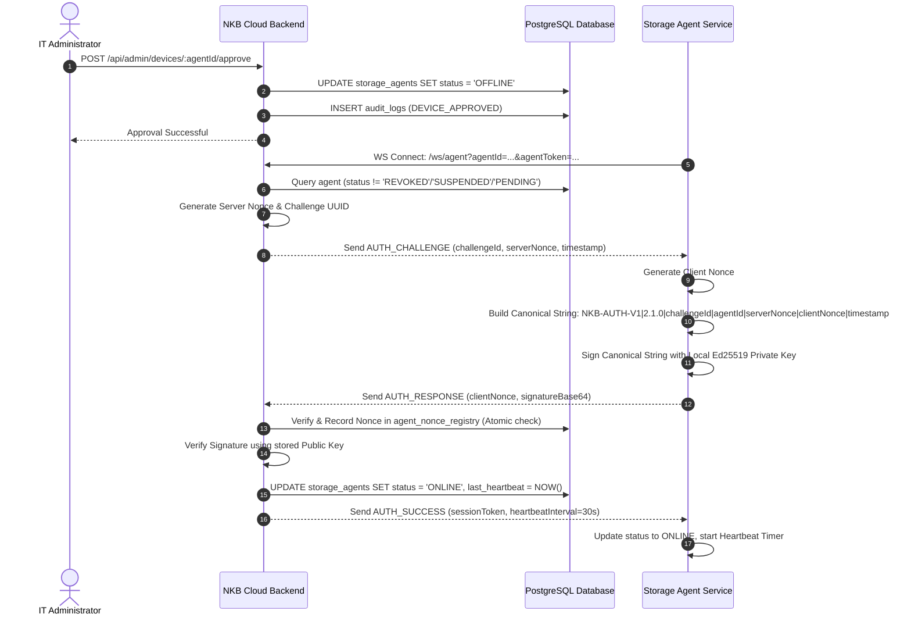

# NKB CLOUD v2.1.0 — AUTOMATIC STORAGE AGENT DEPLOYMENT & ENROLLMENT ARCHITECTURE

**Document Version:** 1.0.0  
**Target Platform:** Windows 10/11 Professional / Enterprise Corporate Workstations  
**Central Ingress:** AlmaLinux 10 VPS with Nginx 1.26.3 Stable (`nginx:1.26.3-alpine@sha256:1eadbb...`)  
**Backend Platform:** Node.js 26.13.0 LTS / Express / PostgreSQL 16.15  
**Protocol Version:** `NKB-AUTH-V1` / `NKB-CMD-V1` (Protocol 2.1.0)  
**Security Model:** Zero-Trust Asymmetric Cryptography (Ed25519) + Atomic Single-Use Nonce Registry  

---

## 1. ARCHITECTURAL OVERVIEW & PURPOSE

The **NKB Cloud Storage Agent** is a secure, lightweight client-side daemon designed to run as a native Windows Service on corporate computers. The agent bridges local company storage volumes with the private NKB Cloud infrastructure, providing high-performance, authenticated, multi-part chunked storage synchronization, deduplication, and file verification.

To eliminate manual technician overhead across enterprise fleets while maintaining absolute zero-trust security boundaries, NKB Cloud v2.1.0 implements an **Automated Corporate Workstation Deployment & Device Enrollment Architecture**.

```
+---------------------------------------------------------------------------------------------------+
|                                  CORPORATE CLIENT COMPUTER (WINDOWS 10/11)                         |
|                                                                                                   |
|   +-----------------------+           +-------------------------------------------------------+   |
|   |   Employee Browser    |           |          NKB Storage Agent Service (Localhost)        |   |
|   |  (React Vite App)     |           |                                                       |   |
|   |                       |           |  - Windows Service / NSSM Daemon                      |   |
|   |  - Probes Loopback    | HTTP GET  |  - Loopback Status API (http://127.0.0.1:51248/status)|   |
|   |    for status         +---------->+  - Isolated Local Ed25519 Keypair Storage             |   |
|   |  - Displays Status /  |           |  - Volume File Engine (NTFS, BitLocker verification)  |   |
|   |    Direct Download    |           |  - Auto-Update Execution Engine                       |   |
|   +-----------+-----------+           +---------------------------+---------------------------+   |
+---------------|---------------------------------------------------|-------------------------------+
                |                                                   |
      HTTPS REST / API                              WSS Bidirectional Channel
 (Port 443 / Reverse Proxy)                     (Port 443 /ws/agent / Reverse Proxy)
                |                                                   |
+---------------v---------------------------------------------------v-------------------------------+
|                            NKB CLOUD PRODUCTION VPS (ALMALINUX 10)                                 |
|                                                                                                   |
|   +-------------------------------------------------------------------------------------------+   |
|   |                  Nginx 1.26.3 Stable Reverse Proxy & Ingress Security Filter               |   |
|   |                   (TLS 1.3 / HSTS / Rate Limiting / WebSocket Connection Upgrade)         |   |
|   +---------------------------------------------+---------------------------------------------+   |
|                                                 | Internal Docker Network                         |
|   +---------------------------------------------v---------------------------------------------+   |
|   |                      NKB Cloud Express Backend & AgentHub Service                         |   |
|   |                                                                                           |   |
|   |   - Device Management API (/api/devices/*)                                                |   |
|   |   - Admin Governance Dashboard (/api/admin/devices/*)                                     |   |
|   |   - Outbound WebSocket Agent Hub (/ws/agent)                                              |   |
|   |   - Cryptographic Handshake & Nonce Replay Registry                                       |   |
|   +---------------------------------------------+---------------------------------------------+   |
|                                                 | Internal Docker Network                         |
|   +---------------------------------------------v---------------------------------------------+   |
|   |                         PostgreSQL 16 Enterprise Database                                 |   |
|   |             (storage_agents, agent_credentials, agent_nonce_registry, audit_logs)          |   |
|   +-------------------------------------------------------------------------------------------+   |
+---------------------------------------------------------------------------------------------------+
```

---

## 2. CORE SYSTEM COMPONENTS

### 2.1 Windows Client Storage Agent
The client daemon is packaged as a standalone Node.js or compiled executable running under NSSM (Non-Sucking Service Manager) or native Windows Service Control Manager (`sc.exe`):
1. **Local Loopback Detection Service (`http://127.0.0.1:51248/status`):**
   - Bound strictly to the loopback interface (`127.0.0.1`).
   - Responds to local browser CORS preflights (`GET /status`).
   - Informs the React frontend of agent installation state, machine hostname, active software version, and connection status.
2. **Outbound Secure WebSocket Client (`wss://cloud.nkb.local/ws/agent`):**
   - Initiates an outbound-only connection to the central NKB Cloud reverse proxy.
   - Requires zero inbound firewall openings or port forwarding on corporate client networks.
   - Automatically reconnects with bounded exponential backoff and randomized jitter (3s to 60s).
3. **Local Cryptographic Key Store:**
   - Generates an Ed25519 asymmetric keypair during first-time enrollment.
   - Stores the private key strictly on the local machine within restricted-permission storage (Windows DPAPI / ACL `SYSTEM` + local Administrator only).
   - Never exposes private keys over network wires or to cloud servers.
4. **Volume Engine & Storage Worker:**
   - Validates physical disk signatures, NTFS filesystem identifiers, and drive letters.
   - Manages encrypted chunk storage, assembly, and SHA-256 verification.

### 2.2 Enterprise Deployment Orchestration
Automated mass deployment across corporate fleets is achieved through standardized enterprise management tools without manual technician visits:
1. **Microsoft Intune / Microsoft Endpoint Configuration Manager (MECM):**
   - Distributed as a Win32 application (`.intunewin`).
   - Uses `scripts/deploy-nkb-agent.ps1` with automated silent execution parameters (`-Silent -EnrollmentToken <TOKEN>`).
   - Verifies installation through file-system presence (`C:\Program Files\NKB\StorageAgent\bin\agent.js`) and service running state (`NKBStorageAgent`).
2. **Active Directory Group Policy (GPO):**
   - Distributed as a Computer Startup Script configured under `Computer Configuration > Policies > Windows Settings > Scripts > Startup`.
   - Runs under `NT AUTHORITY\SYSTEM` context before user login.
3. **Manual / Self-Service Assisted Installation:**
   - Employees logging into NKB Cloud from an unmanaged machine can generate a personal enrollment script directly from their user dashboard.
   - Runs with elevated PowerShell privileges; enrollment token is cryptographically tied to the employee's identity.

---

## 3. END-TO-END DEPLOYMENT & ENROLLMENT LIFECYCLE

### 3.1 Sequence 1: Enterprise Deployment & First-Time Enrollment



### 3.2 Sequence 2: Administrator Approval & Mutual Cryptographic Handshake



---

## 4. LOCAL AGENT DETECTION PROTOCOL

### 4.1 Browser-to-Agent Loopback Detection
Web browsers strictly prohibit web pages from querying native OS processes, registry keys, or local file systems. To provide instantaneous detection of storage agents without requiring insecure custom browser extensions or ActiveX controls, NKB Cloud uses a standard **Loopback HTTP Probing Protocol**:

```
[ Web Browser (https://cloud.nkb.local) ]
                   |
                   | 1. HTTP GET http://127.0.0.1:51248/status (Timeout: 1500ms)
                   v
[ Storage Agent Loopback Server (127.0.0.1:51248) ]
                   |
                   | 2. Returns JSON with Access-Control-Allow-Origin: *
                   v
{
  "installed": true,
  "agentVersion": "2.1.0",
  "machineName": "NKB-CORP-WS014",
  "status": "ONLINE",
  "authenticated": true,
  "keyFingerprint": "9a4b2c1d8e7f...",
  "loopbackPort": 51248
}
```

### 4.2 Security Properties of Loopback Protocol
1. **Loopback Interface Binding:** The HTTP server is bound exclusively to `127.0.0.1`. Remote network callers (LAN or WAN) cannot reach or query the endpoint.
2. **Read-Only Status Response:** The `/status` endpoint exposes no sensitive file contents, private keys, or command execution hooks.
3. **Graceful Fallback:** If the browser request times out (e.g., agent service is stopped or not yet installed), the web application gracefully transitions to the `AGENT_NOT_INSTALLED` UI state, guiding the user to download the installer or contact IT.
4. **No Operating System Elevation Bypass:** Probing the loopback port operates entirely within unprivileged browser sandbox limits.

---

## 5. NETWORK & TOPOLOGY REQUIREMENTS

| Traffic Direction | Source | Destination | Protocol / Port | Purpose |
| :--- | :--- | :--- | :--- | :--- |
| **Local Internal** | Web Browser | Local Host | HTTP / TCP `51248` | Agent presence detection probe (`127.0.0.1` loopback only). |
| **Outbound WAN** | Storage Agent | NKB Reverse Proxy | HTTPS / TCP `443` | Initial enrollment API & installer script download. |
| **Outbound WAN** | Storage Agent | NKB Reverse Proxy | WSS / TCP `443` | Persistent bidirectional WebSocket to `/ws/agent`. |
| **Internal Docker** | Nginx Proxy | Backend Service | HTTP / TCP `5000` | Reverse proxy forwarding with `Upgrade` headers. |
| **Internal Docker** | Backend Service | Database Service | TCP `5432` | PostgreSQL 16 schema queries & audit persistence. |

> [!IMPORTANT]
> Corporate client computers require **ZERO inbound firewall ports open**. All connections to NKB Cloud are outbound over standard HTTPS/WSS (Port 443).

---

## 6. DISASTER RECOVERY & AGENT SURVIVABILITY

1. **Network Disruption & Jitter:** If the corporate network connection drops, the agent automatically retries with exponential backoff (initial delay: 3s, multiplier: 1.5, maximum backoff: 60s, randomized jitter: +/- 20%).
2. **Server Restart & Maintenance:** When NKB Cloud backend restarts or enters maintenance, the agent gracefully closes the WebSocket and transitions to `OFFLINE`. Upon backend restoration, the agent automatically re-initiates the Ed25519 mutual authentication handshake.
3. **Machine Reboot:** The Windows Service is configured with `StartupType = Automatic` and `DelayedAutoStart = True` to ensure all networking and storage drivers are fully initialized before the agent attempts cloud connection.
4. **Volume Disconnection:** If a registered USB or secondary storage volume is unplugged, the agent's volume monitor alerts the backend, safely flagging the volume as `OFFLINE` while keeping the agent daemon connected.
