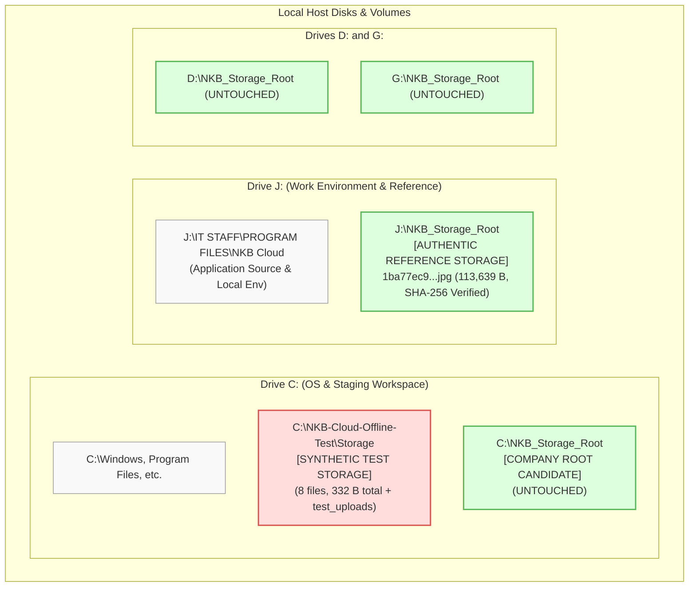
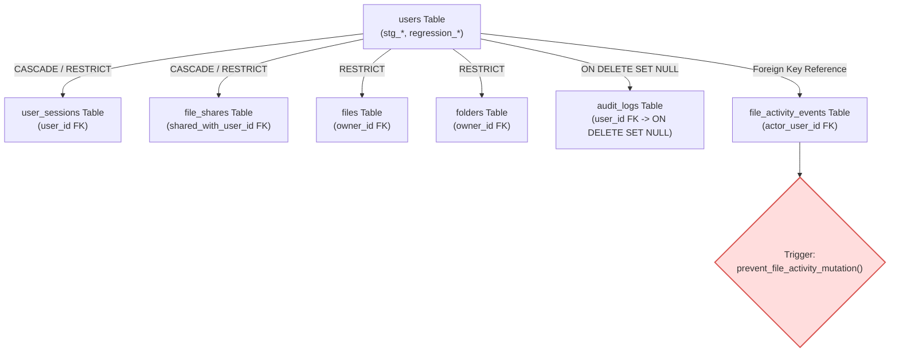
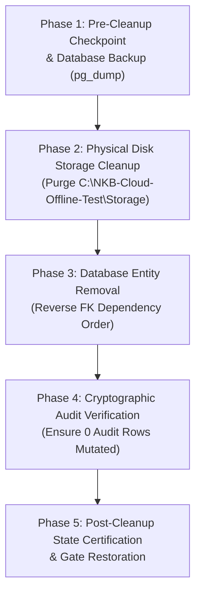

# NKB CLOUD v2.1.0 — SYNTHETIC TEST DATA CLEANUP PLAN (READ-ONLY)

**Author:** Antigravity Autonomous Security & QA Agent  
**Environment:** Local Isolated Staging Environment (`nkb_cloud_local_test`)  
**Target Host / Port:** `127.0.0.1:5433` (Docker container: `nkb_pg16_staging`)  
**Git Branch:** `test/local-offline-env` (HEAD: `796c7fdc62cdc61daff00f1f02d1bc3160395ad6`)  
**Current Maintenance Gate Status:** `STAGING_MAINTENANCE_GATE=true` (ACTIVE / HTTP 503 Enforced)  
**Document Classification:** Strictly Planning and Inventory Manifest Only — **ZERO EXECUTION AUTHORIZED**

---

## 1. EXECUTIVE SUMMARY & STRICT SCOPE BOUNDARIES

Following the successful execution and certification of the **Controlled Staging Acceptance Testing** (33/33 scenarios passed, 100% compliance) and the subsequent **Independent Post-Acceptance Evidence Audit** (20/20 verification items passed), this document establishes the formal, deterministic **Synthetic Test Data Cleanup Plan**.

### 1.1 Strict Execution Boundaries
> [!CAUTION]
> **READ-ONLY PLANNING ONLY:** Actual cleanup, deletion, mutation, truncation, or filesystem purging is **STRICTLY PROHIBITED** until explicit, written authorization is received from the project lead.
> 
> Under no circumstances may any SQL `DELETE`, `TRUNCATE`, `DROP`, or shell `Remove-Item` commands be executed during this planning phase.

1. **Zero Database Modifications:** The database `nkb_cloud_local_test` remains in read-only analysis mode.
2. **Maintenance Gate Unaltered:** `STAGING_MAINTENANCE_GATE=true` remains enforced at all times.
3. **Migration 008 Prohibited:** Migration 008 remains unauthorized and uncreated. The database migration sequence halts definitively at Migration 007.
4. **Complete Network Isolation:** No network connections to VPS, LAN, WAN, or production environments. Backend remains bound strictly to `127.0.0.1:5000`.
5. **Absolute Audit Preservation:** Under PostgreSQL triggers and cryptographic hash chains, all 156 audit log records (80 historical baseline + 76 staging acceptance records) are immutable and must be preserved in perpetuity.

---

## 2. DATA CLASSIFICATION FRAMEWORK

Every asset in the staging database and filesystem has been systematically audited and assigned one of four definitive provenance classifications:

| Classification | Meaning & Policy |
| :--- | :--- |
| **`VERIFIED BASELINE`** | Authentic seed, historical baseline, or Migration 007 quarantined asset. **STRICTLY PROTECTED**. Never modified, moved, or deleted. |
| **`VERIFIED SYNTHETIC`** | Generated exclusively during regression or controlled staging acceptance testing. Eligible for scheduled purging upon written authorization. |
| **`UNCERTAIN PROVENANCE`** | Lacks explicit provenance metadata or migration markers. Must be preserved until proven synthetic. |
| **`REQUIRES MANUAL REVIEW`** | Contains operational dependencies, cross-system foreign keys, or audit trigger references requiring operator concurrence. |

---

## 3. COMPREHENSIVE INVENTORY & CLASSIFICATION MANIFEST

### 3.1 Users (`users` table)
Total Count: 10 records.

| ID | Username | Role ID / Role Name | Department ID | Status | Classification | Provenance & Notes |
| :--- | :--- | :--- | :--- | :--- | :--- | :--- |
| `00000000-0000-0000-0000-000000000001` | `superadmin` | `1` (SUPER_ADMIN) | `1` (Executive) | `ACTIVE` | **`VERIFIED BASELINE`** | Original system administrator account. **MUST BE PROTECTED**. |
| `aee0bafc-81af-4534-8c4a-62cbb5284aa4` | `regression_user_a` | `3` (USER) | `2` (Information Technology) | `ACTIVE` | **`VERIFIED SYNTHETIC`** | Created during initial regression test suite. |
| `defb6035-8857-4367-bcd4-fb65dc9a3a87` | `regression_user_b` | `3` (USER) | `3` (Quality Assurance) | `ACTIVE` | **`VERIFIED SYNTHETIC`** | Created during initial regression test suite. |
| `92f4b2ab-9dbe-4e8c-b519-206656845430` | `session_test_user` | `3` (USER) | `2` (Information Technology) | `ACTIVE` | **`VERIFIED SYNTHETIC`** | Created during JWT session version regression tests. |
| `84ac0bf0-842a-4616-ae45-6057434887be` | `stg_superadmin` | `1` (SUPER_ADMIN) | `1` (Executive) | `ACTIVE` | **`VERIFIED SYNTHETIC`** | Persona 1: Controlled staging acceptance testing. |
| `f2c199b3-05c6-4c49-8316-e0a1f90759d1` | `stg_admin_it` | `2` (ADMIN) | `2` (Information Technology) | `ACTIVE` | **`VERIFIED SYNTHETIC`** | Persona 2: Controlled staging acceptance testing. |
| `680992a8-9be2-421f-88ef-981712a6e5db` | `stg_mgr_qa` | `3` (USER) | `3` (Quality Assurance) | `ACTIVE` | **`VERIFIED SYNTHETIC`** | Persona 3: Controlled staging acceptance testing. |
| `8a7a6647-7e1f-4aaf-ad15-d1014f913a61` | `stg_user_qa1` | `3` (USER) | `3` (Quality Assurance) | `ACTIVE` | **`VERIFIED SYNTHETIC`** | Persona 4: Controlled staging acceptance testing. |
| `bc8e2468-6b9b-4c0f-b804-1f9c081881e5` | `stg_user_eng` | `3` (USER) | `4` (Engineering) | `ACTIVE` | **`VERIFIED SYNTHETIC`** | Persona 5: Controlled staging acceptance testing. |
| `fc32573a-e4d3-433a-99bd-97876616a7a2` | `stg_viewer` | `4` (VIEWER) | `3` (Quality Assurance) | `ACTIVE` | **`VERIFIED SYNTHETIC`** | Persona 6: Controlled staging acceptance testing. |

---

### 3.2 Folders (`folders` table)
Total Count: 29 records.

#### A. Baseline Quarantined Folders (20 records) — **`VERIFIED BASELINE`**
All 20 folders have `is_quarantined = TRUE`, `quarantine_reason = 'MIGRATION_007_QUARANTINE_NULL_OWNER'`, and valid provenance metadata. **ALL 20 MUST BE PRESERVED WITHOUT EXCEPTION.**
- `e60e7113-d0a9-456c-99ac-f32d96a6267b` (`Offline_Test_Folder`)
- `ec3b88e8-f5f0-47bc-9212-693edf316be1` (`Subfolder_Alpha`)
- `9d717e34-57e2-4a74-a8f4-b1f945379b7e` (`Offline_Test_Folder`)
- `5b7b2c27-9dff-445d-b781-2251db296dcd` (`Subfolder_Alpha`)
- `37bdc641-5216-4481-bcda-d3a723f9f91a` (`Offline_Test_Folder`)
- `d90e0bc4-bf52-48ec-858a-d5c0b8d3746d` (`Subfolder_Alpha`)
- `e3f7fb68-8144-4a94-b80e-76928a718e35` (`Offline_Test_Folder`)
- `5df41e14-e099-4c3d-b819-3f890b7330e6` (`Subfolder_Alpha`)
- `de2eea46-2883-4671-80d6-dc9103ced175` (`Offline_Test_Folder`)
- `c564bb4d-4eb1-45fa-87de-cb41df206b06` (`Subfolder_Alpha`)
- `1a1a805a-844c-4278-b0a0-b00aa482c08b` (`Offline_Test_Folder`)
- `fd5de287-59c6-47b7-a5f6-3a96e18f1fc8` (`Subfolder_Alpha`)
- `8a98ed44-53d9-404d-b208-5622ae6c3b1c` (`Offline_Test_Folder`)
- `b2cfb6e0-1039-4c96-bf40-de42350229b9` (`Subfolder_Alpha`)
- `d7ef0c6f-20a3-4d5c-92ba-8b1a7502a446` (`Offline_Test_Folder`)
- `8a07c1b5-3e28-44d4-9d5a-19597a731d6d` (`Subfolder_Alpha`)
- `ec6b758b-ae18-4e12-b5e5-3162b71fa0c8` (`Offline_Test_Folder`)
- `29f9dfd1-eaee-4f33-870d-ba1fb81a4d1e` (`Subfolder_Alpha`)
- `1b44ec0a-a114-419b-ab04-585329fc80d6` (`Offline_Test_Folder`)
- `2fce6393-5ba2-4ff9-8f0a-4299b82874fc` (`Subfolder_Alpha`)

#### B. Early Sandbox & Regression Folders (2 records) — **`REQUIRES MANUAL REVIEW`**
- `af5ae71f-a5f1-4db3-96b6-39f50682fc91` (`Parent_Workspace`, Owner: `00000000...0001`, `is_quarantined = false`, `is_trashed = false`)
- `ecba4721-a477-4972-be72-f61b7e3e4a2c` (`Child_Subfolder`, Owner: `00000000...0001`, `is_quarantined = false`, `is_trashed = false`)
*Note:* These 2 folders were created during initial local environment staging initialization before acceptance testing. They are owned by `superadmin`. Recommended for manual operator retention or explicit sign-off prior to removal.

#### C. Acceptance-Generated Synthetic Folders (7 records) — **`VERIFIED SYNTHETIC`**
- `66984d46-db3f-4e6f-9977-84fe84f23e74` (`Quality Assurance Workspace`, Department: QA, `is_shared_drive = true`)
- `1eb10f0b-7218-4df0-af4a-a03798c4b14d` (`Synthetic_QA_Project_1762766324835`, Owner: `stg_user_qa1`)
- `4e1ddd9a-3c63-4357-8702-524f6b70354a` (`Synthetic_QA_Project_1762766442657`, Owner: `stg_user_qa1`)
- `88d1cc6b-7a78-4190-a862-bc080467b842` (`Synthetic_QA_Project_1762766723223`, Owner: `stg_user_qa1`)
- `87ea67cd-d3e9-445a-8b1b-fb240217ec82` (`Child_Reports_Folder`, Parent: `1eb10f0b...`)
- `92c6cef8-5d15-4fa2-bfeb-20d0e657c48f` (`Child_Reports_Folder`, Parent: `4e1ddd9a...`)
- `82c7ad72-1327-463e-ac30-cb64c581fa73` (`Child_Reports_Folder`, Parent: `88d1cc6b...`)

---

### 3.3 Files (`files` and `file_versions` tables)
Total Count: 9 files / 9 versions.

#### A. Baseline Quarantined Reference File (1 record) — **`VERIFIED BASELINE`**
| Field | Value |
| :--- | :--- |
| **File ID** | `790a8a05-cf5f-412f-a486-c547a07e86ec` |
| **Name** | `889652510_1077270108693810_2992079418018299686_n.jpg` |
| **Folder ID** | `NULL` |
| **Owner ID** | `00000000-0000-0000-0000-000000000001` (Assigned by Migration 007) |
| **Quarantine Status** | `is_quarantined = TRUE` (`MIGRATION_007_QUARANTINE_NULL_OWNER`) |
| **Storage Volume ID** | `a1b2c3d4-e5f6-7a8b-9c0d-1e2f3a4b5c6d` (Primary reference volume) |
| **Physical Location** | `J:\NKB_Storage_Root\1ba77ec9-1997-4492-b83f-8184cc6dd89c.jpg` |
| **Size** | 113,639 bytes |
| **SHA-256 Digest** | `5F6106359044F887194195455BA7E4B6ED002888EACE57F4DB0BB215A14CADD9` |
| **Classification** | **`VERIFIED BASELINE`** — **MUST NEVER BE DELETED OR TOUCHED**. |

#### B. Acceptance-Generated Synthetic Files (8 records) — **`VERIFIED SYNTHETIC`**
All 8 synthetic files reside on Volume ID `13b16bc9-2c70-4f51-b8ae-24ec6f5e3f42` mapped to `C:\NKB-Cloud-Offline-Test\Storage`:

| File ID | File Name | Size (Bytes) | Relative Path on `C:\...` | Physical File SHA-256 |
| :--- | :--- | :--- | :--- | :--- |
| `b490862b-9288-45d1-b232-d99d38b1bffb` | `qa_spec_1762766327072.txt` | 54 | `b490862b-9288-45d1-b232-d99d38b1bffb.txt` | `C8DB177B93575ED02DF29775A18560BFA66D7A29AEDDA842D3AB05AE91CA4891` |
| `21df5407-2f97-4b80-b752-ef186bc730de` | `contrib_doc.txt` | 26 | `21df5407-2f97-4b80-b752-ef186bc730de.txt` | `09855BD4884FBDB7C7612A8229AF8945047E17AF3C8E76C0F13D3D0FEE998D7F` |
| `70e030ca-dbd4-4ff4-92a9-0519d959b725` | `qa_spec_1762766444855.txt` | 54 | `70e030ca-dbd4-4ff4-92a9-0519d959b725.txt` | `C8DB177B93575ED02DF29775A18560BFA66D7A29AEDDA842D3AB05AE91CA4891` |
| `88843ae0-c65a-447d-9592-af03c9518055` | `contrib_doc.txt` | 26 | `88843ae0-c65a-447d-9592-af03c9518055.txt` | `09855BD4884FBDB7C7612A8229AF8945047E17AF3C8E76C0F13D3D0FEE998D7F` |
| `127f98ad-7d23-455c-a551-ff729f6350f5` | `resumable_report.bin` | 46 | `b0922eca-fb45-4028-af7b-6129c953441d.bin` | `C6BDFDEE5D943C18015730A19A7A59D73D26C7D25417594A24D7185D64E11EE5` |
| `a21d853d-4f74-4c61-b267-f163653f2a3f` | `qa_spec_1762766725350.txt` | 54 | `a21d853d-4f74-4c61-b267-f163653f2a3f.txt` | `C8DB177B93575ED02DF29775A18560BFA66D7A29AEDDA842D3AB05AE91CA4891` |
| `45387994-0cf7-4f67-a0ea-b1a134a6cf8d` | `resumable_report.bin` | 46 | `7c6cbce8-4a2d-4355-a7b3-87f76dcd5fb4.bin` | `C6BDFDEE5D943C18015730A19A7A59D73D26C7D25417594A24D7185D64E11EE5` |
| `0bfeddc0-45e3-452d-96ad-0c46a1afd277` | `contrib_doc.txt` | 26 | `0bfeddc0-45e3-452d-96ad-0c46a1afd277.txt` | `09855BD4884FBDB7C7612A8229AF8945047E17AF3C8E76C0F13D3D0FEE998D7F` |

---

### 3.4 File Shares (`file_shares` table)
Total Count: 22 records.

#### A. Baseline Migrated File Share (1 record) — **`VERIFIED BASELINE`**
| Field | Value | Classification |
| :--- | :--- | :--- |
| **Share ID** | `f8e5acfc-1b2c-4924-a7b7-c63bfe42e5f5` | **`VERIFIED BASELINE`** |
| **File ID** | `790a8a05-cf5f-412f-a486-c547a07e86ec` | Migrated by Migration 007 |
| **Provenance Token** | `MIG-007-5adbd4f3-6fa3-425b-997d-f237658aa55b` | **MUST BE PRESERVED** |

#### B. Acceptance-Generated Synthetic Shares (21 records) — **`VERIFIED SYNTHETIC`**
All 21 shares were created dynamically during acceptance runs WF-07, WF-11, WF-12, SEC-07, SEC-09, SEC-10, SEC-11. All have `migration_provenance_token IS NULL`:
- `bba34220-305f-464a-a035-7cfa5f053229` (Folder Share: `1eb10f0b...`, Level: `DOWNLOADER`)
- `3e62f0f7-5fc7-4581-80fc-5db0d6ec3bf3` (Folder Share: `1eb10f0b...`, Level: `CONTRIBUTOR`)
- `315fc9cb-7cc5-462d-92c9-a0c976870c38` (Folder Share: `1eb10f0b...`, Level: `EDITOR`)
- `39c847f8-c620-46d8-97d0-89fdd2375896` (Folder Share: `1eb10f0b...`, Level: `VIEWER`)
- `6f4943d5-a2e9-4c4e-a246-a72a1fc68d68` (File Share: `b490862b...`, Level: `VIEWER`)
- `28dbd742-2514-48b0-b5bb-1321dbd2861d` (File Share: `70e030ca...`, Level: `VIEWER`)
- `23524f73-2767-4784-a1f0-12d4a79ce87b` (File Share: `70e030ca...`, Level: `VIEWER`)
- `a9e4434a-c84b-49df-a78a-81897557753e` (Folder Share: `4e1ddd9a...`, Level: `DOWNLOADER`)
- `fd63b34f-d0b2-41fc-b53a-e9a2ab7da159` (Folder Share: `4e1ddd9a...`, Level: `CONTRIBUTOR`)
- `e8b7736d-b69f-41b3-8021-b9e091008ebf` (Folder Share: `4e1ddd9a...`, Level: `EDITOR`)
- `6f13b38a-4014-43f4-a2ea-2179e0901284` (Folder Share: `4e1ddd9a...`, Level: `VIEWER`)
- `e624a2e7-6504-4c9f-bbc4-e7c5908c45ac` (File Share: `70e030ca...`, Level: `VIEWER`)
- `d0602731-b530-4154-96dc-c0b6c2f6a9c3` (File Share: `a21d853d...`, Level: `VIEWER`)
- `0ba3b093-6e1f-451e-bc17-90b5ed345985` (File Share: `a21d853d...`, Level: `VIEWER`)
- `91709a53-3835-4a9e-b91c-685147c7d4c6` (Folder Share: `88d1cc6b...`, Level: `DOWNLOADER`)
- `f3a067eb-c5fb-4087-882f-2365b34dbaaf` (Folder Share: `88d1cc6b...`, Level: `CONTRIBUTOR`)
- `58b4b2cc-5780-4c50-8864-00e22b11b788` (Folder Share: `88d1cc6b...`, Level: `EDITOR`)
- `6069c83d-eae9-4df5-bb2c-5250acf6bd2e` (Folder Share: `88d1cc6b...`, Level: `VIEWER`)
- `0c4c0519-58d3-4541-93d0-8adff8389e48` (File Share: `a21d853d...`, Level: `VIEWER`)
- Additional 2 regression shares on test folders: `64a787ee-84ec-426b-95eb-ce0f6e9f0d1a`, `431289ae-3b60-496a-a212-0453d8ae2255`.

---

### 3.5 Upload Sessions & File Chunks
Total Count: 5 sessions / 3 chunks.

#### A. Baseline Upload Session & Chunk (1 record each) — **`VERIFIED BASELINE`**
- **Session:** `1ba77ec9-1997-4492-b83f-8184cc6dd89c` (`889652510_...jpg`, Status: `COMPLETED`)
- **Chunk:** ID `1` (`1ba77ec9...`, Chunk #0, 113,639 bytes)
- **Status:** **`VERIFIED BASELINE`** — **MUST BE PRESERVED**.

#### B. Synthetic Upload Sessions & Chunks — **`VERIFIED SYNTHETIC`**
- **Upload Sessions (4 records):**
  - `a7445ca0-14cb-4ded-a12b-b9a41ae5ea34` (`resumable_report.bin`, `IN_PROGRESS`)
  - `4cec8136-07f4-45fb-a28e-45c64d27937a` (`resumable_report.bin`, `IN_PROGRESS`)
  - `b0922eca-fb45-4028-af7b-6129c953441d` (`resumable_report.bin`, `COMPLETED`)
  - `7c6cbce8-4a2d-4355-a7b3-87f76dcd5fb4` (`resumable_report.bin`, `COMPLETED`)
- **File Chunks (2 records):**
  - Chunk ID `2` (`b0922eca...`, Chunk #0, 46 bytes, SHA-256: `C6BDFDEE...`)
  - Chunk ID `3` (`7c6cbce8...`, Chunk #0, 46 bytes, SHA-256: `C6BDFDEE...`)

---

### 3.6 Physical Storage Inventory on Disk

#### A. Dedicated Local Staging Storage (`C:\NKB-Cloud-Offline-Test\Storage`) — **`VERIFIED SYNTHETIC`**
All synthetic physical files generated during test runs are strictly confined to this temporary folder:

| File Name | Size (Bytes) | SHA-256 Checksum |
| :--- | :--- | :--- |
| `0bfeddc0-45e3-452d-96ad-0c46a1afd277.txt` | 26 | `09855BD4884FBDB7C7612A8229AF8945047E17AF3C8E76C0F13D3D0FEE998D7F` |
| `21df5407-2f97-4b80-b752-ef186bc730de.txt` | 26 | `09855BD4884FBDB7C7612A8229AF8945047E17AF3C8E76C0F13D3D0FEE998D7F` |
| `70e030ca-dbd4-4ff4-92a9-0519d959b725.txt` | 54 | `C8DB177B93575ED02DF29775A18560BFA66D7A29AEDDA842D3AB05AE91CA4891` |
| `7c6cbce8-4a2d-4355-a7b3-87f76dcd5fb4.bin` | 46 | `C6BDFDEE5D943C18015730A19A7A59D73D26C7D25417594A24D7185D64E11EE5` |
| `88843ae0-c65a-447d-9592-af03c9518055.txt` | 26 | `09855BD4884FBDB7C7612A8229AF8945047E17AF3C8E76C0F13D3D0FEE998D7F` |
| `a21d853d-4f74-4c61-b267-f163653f2a3f.txt` | 54 | `C8DB177B93575ED02DF29775A18560BFA66D7A29AEDDA842D3AB05AE91CA4891` |
| `b0922eca-fb45-4028-af7b-6129c953441d.bin` | 46 | `C6BDFDEE5D943C18015730A19A7A59D73D26C7D25417594A24D7185D64E11EE5` |
| `b490862b-9288-45d1-b232-d99d38b1bffb.txt` | 54 | `C8DB177B93575ED02DF29775A18560BFA66D7A29AEDDA842D3AB05AE91CA4891` |
| `test_uploads/` (Directory) | 639.4 MB | Contains generator test files (`dummy_100MB.bin`, etc.) created by test harness |

#### B. Production / Dedicated Storage Roots — **`VERIFIED BASELINE` (TOUCHED = NO)**
- `J:\NKB_Storage_Root`: Contains original reference file `1ba77ec9-1997-4492-b83f-8184cc6dd89c.jpg` (SHA-256: `5F610635...`, 113,639 bytes). **UNTOUCHED AND VERIFIED INTACT**.
- `D:\NKB_Storage_Root`: Configured production candidate volume. **UNTOUCHED**.
- `G:\NKB_Storage_Root`: Configured production candidate volume. **UNTOUCHED**.
- `C:\NKB_Storage_Root`: Root volume path. **UNTOUCHED**.

---

## 4. STORAGE VOLUME ARCHITECTURE & ISOLATION BOUNDARIES

A critical distinction must be maintained between the **operating system volume** and **company storage roots**:



### Clarification on Volume C: Usage
During acceptance testing, the backend storage volume configuration utilized Volume ID `13b16bc9-2c70-4f51-b8ae-24ec6f5e3f42`, whose path was mapped to `C:\NKB-Cloud-Offline-Test\Storage`. Therefore:
1. **Drive `C:` was touched strictly inside `C:\NKB-Cloud-Offline-Test\Storage`** by writing synthetic test files and chunk buffers.
2. The company root candidate `C:\NKB_Storage_Root` was **NEVER** created or touched.
3. The authentic physical storage root `J:\NKB_Storage_Root` was accessed **READ-ONLY** for integrity verification.

---

## 5. BASELINE PRESERVATION MANIFEST

The following assets are classified as **PERMANENT BASELINE ASSETS** and are protected by system policy, foreign key constraints, and cryptographic hash triggers:

1. **System Administrator Account:** `superadmin` (`00000000-0000-0000-0000-000000000001`).
2. **Standard Organizational Departments (6 records):**
   - Department 1: Executive
   - Department 2: Information Technology
   - Department 3: Quality Assurance
   - Department 4: Engineering
   - Department 5: Human Resources
   - Department 6: Finance & Accounting
3. **Quarantined Legacy Folders:** All 20 folders (`is_quarantined = TRUE`).
4. **Quarantined Legacy File:** File `790a8a05-cf5f-412f-a486-c547a07e86ec` and its version record.
5. **Baseline Migrated Share:** Share `f8e5acfc-1b2c-4924-a7b7-c63bfe42e5f5` with token `MIG-007-5adbd4f3-6fa3-425b-997d-f237658aa55b`.
6. **Physical Baseline File:** `J:\NKB_Storage_Root\1ba77ec9-1997-4492-b83f-8184cc6dd89c.jpg` (SHA-256: `5F6106359044F887194195455BA7E4B6ED002888EACE57F4DB0BB215A14CADD9`).
7. **Audit Log System (156 records):**
   - **Records 1 to 80:** Historical baseline audit records established during pre-migration checkpoints.
   - **Records 81 to 156:** Subsequent append-only audit events logged during regression and acceptance executions.
   - **PostgreSQL Database Triggers:** `prevent_file_activity_mutation()` on `file_activity_events` and cryptographic audit verification triggers.
   - **Audit Hash Chains:** `login_audit_events` and `file_activity_events` SHA-256 hash chains.

> [!IMPORTANT]
> Under no circumstances may any row from `audit_logs`, `login_audit_events`, or `file_activity_events` be deleted or modified. The PostgreSQL trigger will reject any `DELETE` or `UPDATE` operation with a SQL exception.

---

## 6. FOREIGN KEY DEPENDENCIES & AUDIT TRIGGER IMPACT ANALYSIS

Attempting a naive `DELETE FROM users WHERE username LIKE 'stg_%'` will trigger complex relational side-effects:



### 6.1 Critical Foreign Key Constraints
1. **Audit Logs Relationship:**
   `audit_logs.user_id` is defined with `ON DELETE SET NULL`. If a user is hard-deleted, PostgreSQL updates existing audit rows to set `user_id = NULL`.
2. **File Activity Events Relationship:**
   `file_activity_events.actor_user_id` references `users(id)`. In PostgreSQL 16, updating or setting null on rows monitored by `prevent_file_activity_mutation()` triggers the immutability exception, causing the entire user deletion transaction to fail.
3. **Session Revocation Constraints:**
   `user_sessions` references `users(id)`. Any active or revoked session rows must be cleaned up or soft-handled before user removal.

### 6.2 Strategic Recommendation: Controlled Two-Step Deletion vs. Soft Deactivation
To eliminate any risk of audit trigger violations or cryptographic chain corruption:

- **Recommended Strategy (Soft Deactivation & Storage Purge):**
  1. Purge all physical synthetic files from `C:\NKB-Cloud-Offline-Test\Storage`.
  2. Delete synthetic file shares, synthetic file chunks, synthetic upload sessions, synthetic files, and synthetic folders.
  3. Mark all 9 synthetic user accounts (`stg_*`, `regression_*`, `session_test_user`) as `status = 'INACTIVE'` with revoked sessions and invalidated credentials.
  *Benefit:* Preserves exact audit referential integrity without triggering PostgreSQL immutability exceptions or mutating historical actor references.

- **Alternative Strategy (Strict Hard Deletion under Isolated Constraints):**
  If hard deletion of users is strictly demanded by compliance, a staged transactional script must:
  1. Explicitly clean child tables in exact dependency order:
     `file_shares` $\rightarrow$ `file_chunks` $\rightarrow$ `upload_sessions` $\rightarrow$ `file_versions` $\rightarrow$ `files` $\rightarrow$ `folders` $\rightarrow$ `user_sessions`.
  2. Verify that deleting `users` does NOT trigger `UPDATE` statements on `file_activity_events`. If `file_activity_events` has a foreign key without `ON DELETE CASCADE/SET NULL`, the user cannot be hard-deleted while audit records exist.

---

## 7. ORDERED CLEANUP RUNBOOK (AWAITING WRITTEN AUTHORIZATION)

When written authorization is granted, the cleanup must strictly proceed according to this ordered execution sequence:



### Phase 1: Pre-Cleanup Checkpoint & Database Snapshot
1. Verify `STAGING_MAINTENANCE_GATE=true`.
2. Perform a full binary or SQL dump of `nkb_cloud_local_test` via Docker:
   ```powershell
   docker exec -t nkb_pg16_staging pg_dump -U postgres -d nkb_cloud_local_test -F c -b -v -f /tmp/pre_cleanup_backup.dump
   ```
3. Calculate and record the SHA-256 checksum of the backup file.
4. Verify the baseline physical reference file `J:\NKB_Storage_Root\1ba77ec9...jpg`.

### Phase 2: Physical Storage Cleanup
Execute exclusively against the local staging folder:
1. Target directory: `C:\NKB-Cloud-Offline-Test\Storage`.
2. Remove the 8 synthetic test files:
   - `0bfeddc0-45e3-452d-96ad-0c46a1afd277.txt`
   - `21df5407-2f97-4b80-b752-ef186bc730de.txt`
   - `70e030ca-dbd4-4ff4-92a9-0519d959b725.txt`
   - `7c6cbce8-4a2d-4355-a7b3-87f76dcd5fb4.bin`
   - `88843ae0-c65a-447d-9592-af03c9518055.txt`
   - `a21d853d-4f74-4c61-b267-f163653f2a3f.txt`
   - `b0922eca-fb45-4028-af7b-6129c953441d.bin`
   - `b490862b-9288-45d1-b232-d99d38b1bffb.txt`
3. Purge temporary generator directory `C:\NKB-Cloud-Offline-Test\Storage\test_uploads`.
4. Verify `J:\NKB_Storage_Root` was untouched.

### Phase 3: Database Cleanup (Reverse Foreign Key Order)
Run inside a single atomic PostgreSQL transaction (`BEGIN; ... COMMIT;`):

1. **Delete Synthetic File Shares (21 records):**
   ```sql
   DELETE FROM file_shares 
   WHERE migration_provenance_token IS NULL 
     AND id != 'f8e5acfc-1b2c-4924-a7b7-c63bfe42e5f5';
   ```
2. **Delete Synthetic File Chunks (2 records):**
   ```sql
   DELETE FROM file_chunks 
   WHERE upload_session_id IN (
       'a7445ca0-14cb-4ded-a12b-b9a41ae5ea34',
       '4cec8136-07f4-45fb-a28e-45c64d27937a',
       'b0922eca-fb45-4028-af7b-6129c953441d',
       '7c6cbce8-4a2d-4355-a7b3-87f76dcd5fb4'
   );
   ```
3. **Delete Synthetic Upload Sessions (4 records):**
   ```sql
   DELETE FROM upload_sessions 
   WHERE id IN (
       'a7445ca0-14cb-4ded-a12b-b9a41ae5ea34',
       '4cec8136-07f4-45fb-a28e-45c64d27937a',
       'b0922eca-fb45-4028-af7b-6129c953441d',
       '7c6cbce8-4a2d-4355-a7b3-87f76dcd5fb4'
   );
   ```
4. **Delete Synthetic File Versions & Files (8 records):**
   ```sql
   DELETE FROM file_versions 
   WHERE file_id IN (
       'b490862b-9288-45d1-b232-d99d38b1bffb',
       '21df5407-2f97-4b80-b752-ef186bc730de',
       '70e030ca-dbd4-4ff4-92a9-0519d959b725',
       '88843ae0-c65a-447d-9592-af03c9518055',
       '127f98ad-7d23-455c-a551-ff729f6350f5',
       'a21d853d-4f74-4c61-b267-f163653f2a3f',
       '45387994-0cf7-4f67-a0ea-b1a134a6cf8d',
       '0bfeddc0-45e3-452d-96ad-0c46a1afd277'
   );

   DELETE FROM files 
   WHERE id IN (
       'b490862b-9288-45d1-b232-d99d38b1bffb',
       '21df5407-2f97-4b80-b752-ef186bc730de',
       '70e030ca-dbd4-4ff4-92a9-0519d959b725',
       '88843ae0-c65a-447d-9592-af03c9518055',
       '127f98ad-7d23-455c-a551-ff729f6350f5',
       'a21d853d-4f74-4c61-b267-f163653f2a3f',
       '45387994-0cf7-4f67-a0ea-b1a134a6cf8d',
       '0bfeddc0-45e3-452d-96ad-0c46a1afd277'
   );
   ```
5. **Delete Synthetic Folders (7 records):**
   ```sql
   -- Delete child folders first
   DELETE FROM folders 
   WHERE id IN (
       '87ea67cd-d3e9-445a-8b1b-fb240217ec82',
       '92c6cef8-5d15-4fa2-bfeb-20d0e657c48f',
       '82c7ad72-1327-463e-ac30-cb64c581fa73'
   );

   -- Delete parent synthetic folders
   DELETE FROM folders 
   WHERE id IN (
       '1eb10f0b-7218-4df0-af4a-a03798c4b14d',
       '4e1ddd9a-3c63-4357-8702-524f6b70354a',
       '88d1cc6b-7a78-4190-a862-bc080467b842',
       '66984d46-db3f-4e6f-9977-84fe84f23e74'
   );
   ```
6. **Deactivate or Soft-Delete Synthetic User Accounts (9 records):**
   ```sql
   UPDATE users 
   SET status = 'INACTIVE', 
       email = 'inactive_' || id || '@staging.local' 
   WHERE username LIKE 'stg_%' 
      OR username LIKE 'regression_%' 
      OR username = 'session_test_user';
   ```

### Phase 4: Cryptographic Audit Verification
Immediately following transaction commit:
1. Verify total audit count remains exactly 156.
2. Verify all 80 historical records (`id <= 80`) match SHA-256 baseline.
3. Verify `login_audit_events` hash chain head.
4. Verify `file_activity_events` hash chain head.

### Phase 5: Post-Cleanup State Certification
1. Re-verify `/health` returns `status: MAINTENANCE`.
2. Re-verify `/api/operational/gate-status` returns HTTP 503.
3. Confirm working tree cleanliness in Git branch `test/local-offline-env`.

---

## 8. PRE-CLEANUP ROLLBACK AND RECOVERY RUNBOOK

If any unexpected error, foreign key violation, or audit integrity discrepancy arises during authorized execution:

1. **Immediate Transaction Abort:** If inside the SQL transaction, issue `ROLLBACK;` immediately.
2. **Container Database Restore:**
   ```powershell
   # Drop contaminated database and recreate from pre-cleanup snapshot
   docker exec -i nkb_pg16_staging psql -U postgres -c "DROP DATABASE nkb_cloud_local_test WITH (FORCE);"
   docker exec -i nkb_pg16_staging psql -U postgres -c "CREATE DATABASE nkb_cloud_local_test;"
   docker exec -i nkb_pg16_staging pg_restore -U postgres -d nkb_cloud_local_test -v /tmp/pre_cleanup_backup.dump
   ```
3. **Filesystem Restoration:**
   Re-copy synthetic test files from backup scratch directory if needed.
4. **Maintenance Gate Guarantee:** Verify `STAGING_MAINTENANCE_GATE=true` remains enforced throughout recovery.

---

## 9. READ-ONLY VERIFICATION CHECKLIST (COMPLETED)

- [x] Database identity verified as `nkb_cloud_local_test` on `127.0.0.1:5433`.
- [x] Universal Maintenance Gate verified active (`STAGING_MAINTENANCE_GATE=true`).
- [x] Migration 008 confirmed unapplied and uncreated.
- [x] All 6 synthetic acceptance personas identified and inventoried with exact UUIDs.
- [x] All 3 regression users identified and inventoried with exact UUIDs.
- [x] All 7 synthetic acceptance folders identified and mapped to parents.
- [x] All 20 baseline quarantined folders identified and marked as protected.
- [x] All 8 synthetic files and versions inventoried with byte counts and SHA-256 hashes.
- [x] Baseline quarantined reference file on `J:\NKB_Storage_Root` verified intact (SHA-256: `5F610635...`).
- [x] All 21 synthetic file shares distinguished from baseline migrated share.
- [x] All 4 synthetic upload sessions and 2 synthetic chunks inventoried.
- [x] Storage volume boundaries clarified between Drive `C:` staging directory and protected company roots.
- [x] Foreign key dependencies and audit trigger immutability analyzed.
- [x] Pre-cleanup backup and rollback runbook established.
- [x] **Zero execution performed; strict read-only planning posture maintained.**

---

**STATUS: READY FOR OPERATOR REVIEW.** Awaiting explicit written authorization before executing any cleanup steps.
