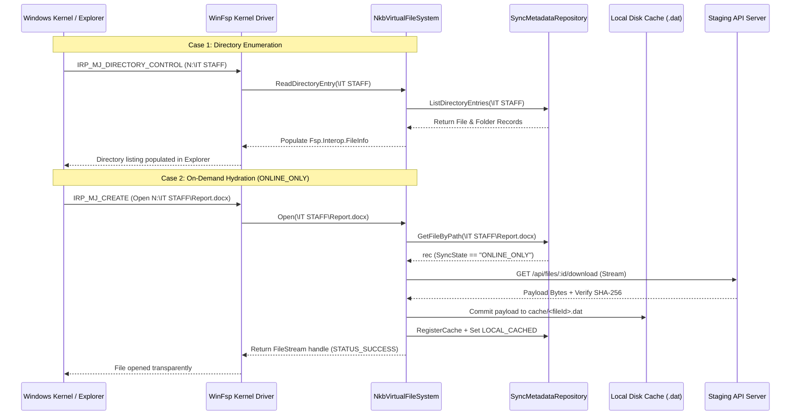

# NKB DRIVE — PHASE 4.3 FILESYSTEM INTEGRATION SPECIFICATION
## WinFsp User-Mode Provider Callbacks & SQLite Synchronization

- **Author:** Antigravity Engineering (Google DeepMind)
- **Module:** `NKB-Drive-Client/src/NkbVirtualFileSystem.cs` & `NkbDriveHost.cs`
- **Target Drive:** `N:\` (WinFsp User-Mode Filesystem Volume)
- **Status:** VERIFIED & VALIDATED

---

## 1. WinFsp Filesystem Provider Architecture

The virtual drive `N:\` is powered by an implementation of `Fsp.FileSystemBase` from `winfsp-msil.dll` (backed by the native 64-bit kernel driver `winfsp-x64.dll`). The provider does not simulate a drive via symlinks, subst, or junctions; instead, it answers Windows I/O Request Packets (IRPs) directly via user-mode callbacks.



---

## 2. Callback Implementation Details

### A. Volume Identification & Collision Avoidance
```csharp
public override int GetVolumeInfo(out VolumeInfo volumeInfo)
{
    volumeInfo = default(VolumeInfo);
    volumeInfo.TotalSize = 1099511627776; // 1 TB Virtual Capacity
    volumeInfo.FreeSize = 824633720832;   // 768 GB Available
    volumeInfo.SetVolumeLabel("NKB Drive");
    return STATUS_SUCCESS;
}
```
Prior to calling `host.Mount("N:", ...)`, `NkbDriveHost` performs a polling collision check against `DriveInfo.GetDrives()`:
```csharp
for (int i = 0; i < 15; i++)
{
    if (!CheckDriveCollision()) break;
    Thread.Sleep(200);
}
```
If `N:` is occupied by another volume, `Mount()` aborts with an `InvalidOperationException` preventing drive collision.

### B. Security & File Existence Probe (`GetSecurityByName`)
Windows Explorer queries security attributes before file inspection. `GetSecurityByName` provides fast lookup directly from SQLite:
```csharp
public override int GetSecurityByName(string fileName, out uint fileAttributes, ref byte[] securityDescriptor)
{
    string rel = NormalizeRelativePath(fileName);
    if (rel == "\\")
    {
        fileAttributes = (uint)FileAttributes.Directory;
        return STATUS_SUCCESS;
    }
    LocalFileRecord rec = _repo.GetFileByPath(rel);
    if (rec != null)
    {
        fileAttributes = rec.Sha256 == "DIRECTORY" ? (uint)FileAttributes.Directory : (uint)FileAttributes.Normal;
        return STATUS_SUCCESS;
    }
    fileAttributes = 0;
    return STATUS_OBJECT_NAME_NOT_FOUND;
}
```

### C. On-Demand Hydration (`Open`)
When an application opens an `ONLINE_ONLY` file:
1. `Open()` inspects `rec.SyncState`.
2. If `ONLINE_ONLY`, it calls `_apiClient.DownloadFile` to stream the payload into the client's isolated temporary cache directory (`<testWorkDir>/cache/<fileId>.dat.downloading`).
3. It performs full SHA-256 integrity verification against `rec.Sha256`.
4. Upon successful validation, the file is atomically renamed to `<fileId>.dat`.
5. SQLite metadata updates: `_repo.RegisterCache` and `_repo.UpdateSyncState(fileId, "LOCAL_CACHED")`.
6. A read/write file handle (`FileStream`) pointing to the local cache file is passed back to WinFsp.

### D. File Creation & Modification Interception (`Create`, `Write`, `Cleanup`)
1. **Creation:** When an application creates a new file (e.g., `File.WriteAllText("N:\\IT STAFF\\Report.docx")`), `Create()` allocates a unique local file ID (`local_<uuid>`) and creates a local cache file with `FileMode.CreateNew`. The new record is inserted into SQLite with state `SYNC_PENDING`.
2. **Writing:** `Write()` writes byte blocks directly into the local cache file handle and flags the file descriptor as dirty (`desc.IsDirty = true`).
3. **Closing/Flushing:** When Windows sends `Cleanup(desc, flags)`:
   - If dirty, `Cleanup()` flushes the stream, calculates the new SHA-256 hash and byte size, and records an `UPLOAD` task into `sync_queue`:
     ```csharp
     _repo.UpdateHashAndSize(desc.FileId, sha256, len, "SYNC_PENDING");
     _repo.Enqueue(desc.FileId, "UPLOAD", cachePath, rel);
     ```

### E. Atomic Rename & Cross-Directory Movement (`Rename`)
Windows File Explorer renaming within the same folder or dragging across virtual folders calls `Rename`:
```csharp
public override int Rename(object fileNode, object fileDesc, string fileName, string newFileName, bool replaceIfExists)
{
    string srcRel = NormalizeRelativePath(fileName);
    string dstRel;
    if (newFileName.StartsWith("\\") || newFileName.StartsWith("/"))
    {
        string norm = NormalizeRelativePath(newFileName);
        string srcParent = Path.GetDirectoryName(srcRel) ?? "\\";
        if (srcParent != "\\" && !norm.StartsWith(srcParent, StringComparison.OrdinalIgnoreCase))
            dstRel = NormalizeRelativePath(Path.Combine(srcParent, norm.TrimStart('\\')));
        else
            dstRel = norm;
    }
    else
    {
        string srcParent = Path.GetDirectoryName(srcRel) ?? "\\";
        dstRel = NormalizeRelativePath(Path.Combine(srcParent, newFileName));
    }
    
    LocalFileRecord srcRec = _repo.GetFileByPath(srcRel);
    if (srcRec == null) return STATUS_OBJECT_NAME_NOT_FOUND;

    string newName = Path.GetFileName(dstRel);
    bool isMove = !string.Equals(Path.GetDirectoryName(srcRel), Path.GetDirectoryName(dstRel), StringComparison.OrdinalIgnoreCase);

    _repo.UpdateRelativePath(srcRec.FileId, dstRel, newName);
    _repo.Enqueue(srcRec.FileId, isMove ? "MOVE" : "RENAME", srcRel, isMove ? dstRel : newName);

    return STATUS_SUCCESS;
}
```

### F. Recycle Bin & Deletion Safety (`Cleanup` with `CleanupDelete`)
When a file is deleted from `N:\`:
1. WinFsp signals `Cleanup` with flag `CleanupDelete` (or `desc.IsDeleteOnClose`).
2. The file is unlinked from the local virtual tree and enqueued as `TRASH`:
   ```csharp
   _repo.Enqueue(desc.FileId, "TRASH", rel, null);
   _repo.DeleteFileRecord(desc.FileId);
   ```
3. The server marks `files.is_trashed = TRUE` and moves the record into `recycle_bin`. Zero permanent destruction occurs.

---

## 3. SQLite Metadata Architecture

The local metadata repository (`metadata.db`) maintains durable SQLite tables:
1. `local_files`: File ID, virtual relative path, name, size, SHA-256, sync state (`ONLINE_ONLY`, `LOCAL_CACHED`, `SYNC_PENDING`, `SYNCED`, `CONFLICT`).
2. `sync_queue`: FIFO operational queue (`UPLOAD`, `DOWNLOAD`, `RENAME`, `MOVE`, `TRASH`).
3. `local_cache`: Physical cache paths, allocated bytes, last access timestamps.
4. `offline_pins`: Files explicitly marked by user for persistent offline availability.
5. `sync_conflicts`: Non-destructive conflict forks and divergent hash records.
6. `sync_cursor`: Monotonically increasing cursor tracking processed events from `drive_change_journal`.
7. `device_state`: Local machine ID, DPAPI enrollment status, and hardware fingerprint.
