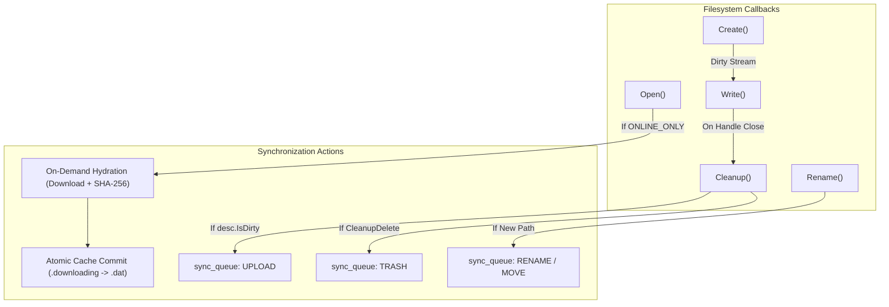

# NKB DRIVE — PHASE 4.3 INTEGRATION DESIGN SPECIFICATION
## Component Dependency Architecture, Lifecycle Mappings, and Safety Workflows

- **Author:** Antigravity Engineering (Google DeepMind)
- **Target Drive:** Virtual Volume `N:\` (WinFsp)
- **Host Infrastructure:** NKB Cloud Enterprise v2.1.0 Staging
- **Status:** APPROVED ARCHITECTURAL SPECIFICATION

---

## 1. Component Dependency Map

```
WinFsp Virtual Filesystem Provider (NkbVirtualFileSystem)
    │
    ├──> SyncMetadataRepository (SQLite metadata.db)
    │        ├── local_files (Virtual directory tree & sync states)
    │        ├── sync_queue (Durable FIFO upload/download/trash queue)
    │        ├── local_cache (Physical cache paths & size tracking)
    │        ├── offline_pins (Persistent pinned status)
    │        └── sync_cursor (Journal replay position)
    │
    ├──> DpapiVault (vault.dat)
    │        └── CryptProtectData (Encrypted JWT token, Device ID, Staging URL)
    │
    ├──> SyncEngine (SyncEngine.cs)
    │        ├── Worker thread polling sync_queue
    │        └── Backpressure, exponential retry (up to 5 attempts), failure status
    │
    └──> StagingCloudClient (StagingCloudClient.cs)
             └── REST HTTP Client (/api/v1/drive/ & /api/files/)
                     │
                     ▼
             NKB Cloud Staging Backend (Node.js Express + PG 16 Staging)
```

---

## 2. Callback-to-Sync Operational Mappings



### Detailed Lifecycle Mappings:

| Action / Event | WinFsp Callback | SQLite Action | Staging API Interaction |
| :--- | :--- | :--- | :--- |
| **Enumerate Directory** | `ReadDirectoryEntry` | `ListDirectoryEntries(parentPath)` | None (zero latency local query). |
| **Open Online File** | `Open` | If `ONLINE_ONLY`, trigger download. Update state to `LOCAL_CACHED`. | `GET /api/files/:id/download` |
| **Open Offline Pinned**| `Open` | State is `OFFLINE_PINNED`. Return local cache handle. | None (100% offline access). |
| **New File Creation** | `Create` | Insert into `local_files` with `SYNC_PENDING`. Create cache `.dat`. | None (deferred until close). |
| **File Edit / Append** | `Write` -> `Cleanup` | Recalculate SHA-256 and size. Enqueue `UPLOAD` in `sync_queue`. | Upload processed by `SyncEngine` worker via `POST /api/files/upload/direct`. |
| **Rename in Folder** | `Rename` | Update `relative_path` and `name`. Enqueue `RENAME`. | `PUT /api/files/:id/rename` (`{ newName }`). |
| **Move Folder / Path** | `Rename` | Update `relative_path`. Enqueue `MOVE`. | `PUT /api/files/:id/move` (`{ targetFolderId }`). |
| **Delete File** | `Cleanup` (delete flag) | Unlink from `local_files`. Enqueue `TRASH`. | `POST /api/files/:id/trash` (Recycle Bin). |
| **Evict Cache** | Client Cache Manager | Remove from `local_cache`. Reset state to `ONLINE_ONLY`. Delete `.dat`. | None (**Zero deletion on server**). |

---

## 3. High-Reliability & Data Safety Specifications

### A. Online-Only On-Demand Hydration
- Files marked `ONLINE_ONLY` appear in Windows File Explorer with their full name, attributes, and file size.
- Bytes are not fetched across the network until an application (e.g. Word, Notepad, Chrome) initiates a read handle.
- The stream downloads into `<cacheDir>/<fileId>.dat.downloading`.
- The full file is hashed with SHA-256. If the hash matches `local_files.sha256`, the file is atomically renamed to `<fileId>.dat`, and its state transitions to `LOCAL_CACHED`.

### B. Offline-Pinned Reads
- Items marked as pinned (`repo.PinItem(fileId, ...)`) have their cache entries locked.
- Cache eviction routines ignore pinned files.
- Reads never contact the cloud server, providing seamless access on airplanes or in disconnected facilities.

### C. Atomic Cache Commits & Interruption Recovery
- Downloads in progress are never written directly to the target `.dat` path.
- If network connectivity fails midway, the `.downloading` file is purged or retained as a resumable temporary segment without corrupting the active cache or metadata store.

### D. Safe Cache Eviction (Zero Cloud Deletion)
- `repo.EvictCache(fileId)` removes local tracking and deletes the client workstation's `.dat` file.
- It strictly updates the local state to `ONLINE_ONLY`.
- **Under no circumstances does eviction send an HTTP DELETE or TRASH to the NKB Cloud server.** The central company file remains untouched.

### E. Optimistic Concurrency & Conflict Preservation
- Before committing local changes to a previously hydrated file, `StagingCloudClient` calls `POST /api/v1/drive/files/validate-version`.
- If another user modified the file on the web application or another workstation, the server returns status `CONFLICT`.
- The client automatically invokes `POST /api/v1/drive/files/conflict-copy` creating a non-destructive fork:
  `Filename [Conflict-MachineName].ext`
- Both versions are preserved side-by-side with full revision history.

### F. Network Recovery & Application Restart Recovery
- If network connection drops:
  - Local virtual filesystem operations continue uninterrupted on `N:\`.
  - Operations accumulate safely in SQLite `sync_queue`.
- When connectivity resumes:
  - `SyncEngine` worker resumes FIFO drainage.
- If the application crashes or machine reboots:
  - SQLite transaction journaling guarantees zero metadata corruption.
  - On restart, `NkbDriveHost` reads the durable state, verifies drive letter availability, remounts `N:`, and resumes queue processing.
