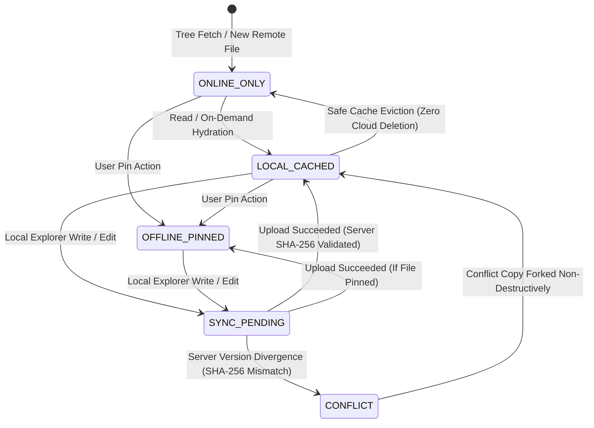

# NKB DRIVE — PHASE 4.3 WINFSP INTEGRATION DESIGN
## Native Windows Virtual Filesystem Driver & Hybrid Sync Architecture

**Document Version:** 1.0.0  
**Date:** November 13, 2026  
**Auditor / Architect:** Antigravity AI Engine  
**Component:** User-Mode Virtual Filesystem Driver (`WinFsp.Net` / `Fsp.FileSystemBase`)  
**Mount Target:** Dedicated Virtual Drive `N:\`  
**Host Environment:** Windows 10 & Windows 11 x64  
**Integration Scope:** WinFsp + SQLite Metadata + SyncEngine + DPAPI Vault + Staging API  
**Status:** RECONCILED & FACTUALLY VERIFIED  

---

## 1. COMPONENT INTEGRATION ARCHITECTURE

The NKB Drive architecture seamlessly bridges user-space Windows filesystem I/O requests from Windows File Explorer and Win32 applications directly to the self-hosted NKB Cloud backend:

```mermaid
flowchart TD
    subgraph User Mode Applications
        EXPLORER["Windows File Explorer / Win32 Apps"]
    end

    subgraph Kernel Space
        WINFSP_SYS["WinFsp Kernel Driver (winfsp.sys)"]
    end

    subgraph NKB Drive Client Process (C# x64)
        HOST["NkbDriveHost (Mount Point Manager)"]
        VFS["NkbVirtualFileSystem (Fsp.FileSystemBase)"]
        SQLITE["SqliteNative & SyncMetadataRepository (metadata.db)"]
        ENGINE["SyncEngine (Transaction Queue Worker)"]
        CACHE["Local Disk Cache (.dat)"]
        VAULT["DpapiVault (vault.dat)"]
        CLIENT["StagingApiClient (REST & Streaming)"]
    end

    subgraph NKB Cloud Enterprise v2.1.0 (Port 5000)
        SERVER["Express Server & Auth Gate"]
        PG["PostgreSQL 16 (nkb_drive_staging)"]
        STORAGE["Physical Storage Agent (J:\, D:\)"]
    end

    EXPLORER <-->|Win32 File APIs| WINFSP_SYS
    WINFSP_SYS <-->|IPC Callbacks| VFS
    HOST -->|Mount 'N:' / Unmount| VFS
    VFS <-->|Metadata & Tree Queries| SQLITE
    VFS <-->|Read/Write Streams| CACHE
    VFS -->|Enqueue Write/Rename/Trash| SQLITE
    ENGINE <-->|Process Queue| SQLITE
    ENGINE -->|Fetch Token & Device ID| VAULT
    ENGINE <-->|HTTP Upload/Download/Trash| CLIENT
    CLIENT <-->|REST API / Byte Streaming| SERVER
    SERVER <-->|Delta Change Journal & Permissions| PG
    SERVER <-->|Physical File Payload| STORAGE
```

---

## 2. WINFSP FILESYSTEM PROVIDER LIFECYCLE CALLBACKS

`NkbVirtualFileSystem` extends `Fsp.FileSystemBase` to handle all standard NT filesystem operations:

### 2.1 Initialization & Volume Mounting
- **`Init(object host)`**:
  - Initializes volume characteristics: `SectorSize = 512`, `SectorsPerAllocationUnit = 1`, `MaxComponentLength = 255`, `CaseSensitiveSearch = false`, `CasePreservedNames = true`, `UnicodeOnDisk = true`, `PersistentAcls = false`.
  - Sets file system name: `"NKBFS"`.
- **`GetVolumeInfo(out VolumeInfo volumeInfo)`**:
  - Returns total capacity and free byte counts reported by the active NKB Cloud storage pool.
  - Volume label: `"NKB Drive"`.
- **`GetSecurityByName(string fileName, ...)`**:
  - Synthesizes NT security descriptors allowing standard authenticated Windows user read/write access without requiring domain Active Directory ACL storage on virtual nodes.

---

### 2.2 File & Directory Open / Create
- **`Open(string fileName, uint createOptions, uint grantedAccess, ...)`**:
  1. Validates canonical path via `NormalizeRelativePath()`. Prevents directory traversal (`..`, invalid separators).
  2. Resolves root directory `\`: returns directory descriptor.
  3. Queries local SQLite table `local_files`:
     - If record exists: Creates `VfsNodeDesc` holding `FileId`, `RelativePath`, `IsDirectory`.
     - If record missing: Returns NT status `0xC0000034` (`STATUS_OBJECT_NAME_NOT_FOUND`).
  4. Hydration check: If file is `ONLINE_ONLY` and `Read` or `Write` access is requested, flags descriptor for on-demand streaming.
- **`Create(string fileName, uint createOptions, uint grantedAccess, uint fileAttributes, ...)`**:
  1. If `FILE_DIRECTORY_FILE` option is specified:
     - Generates new UUID for folder.
     - Enqueues `FOLDER_CREATE` in SQLite `sync_queue`.
     - Adds record to `local_files` with `size_bytes = 0` and `sync_state = 'SYNCED'`.
  2. If file creation:
     - Generates new file UUID.
     - Allocates cache backing file in `<CacheDir>/<UUID>.dat`.
     - Enqueues `UPLOAD` operation in `sync_queue`.
     - Returns open stream descriptor with `IsDirty = true`.

---

### 2.3 Read, Write & Streaming I/O
- **`Read(object fileNode, object fileDesc, IntPtr buffer, ulong offset, uint length, out uint bytesTransferred)`**:
  1. If file state is `ONLINE_ONLY`:
     - Initiates bounded on-demand hydration stream from `/api/files/:id/download`.
     - Streams bytes directly to `<CacheDir>/<UUID>.dat`.
     - Verifies computed SHA-256 matches metadata hash.
     - Atomically commits cache file and updates SQLite state to `LOCAL_CACHED`.
  2. Opens `<CacheDir>/<UUID>.dat` for reading.
  3. Seeks to `offset` and copies `length` bytes into unmanaged memory `IntPtr buffer`.
  4. Returns `bytesTransferred`.
- **`Write(object fileNode, object fileDesc, IntPtr buffer, ulong offset, uint length, ...)`**:
  1. Reads bytes from `IntPtr buffer` using bounded 64KB slices.
  2. Seeks to `offset` on local backing file stream.
  3. Writes buffer and updates file length.
  4. Marks `desc.IsDirty = true` and updates `local_files` record with `sync_state = 'SYNC_PENDING'`.

---

### 2.4 Flush, Cleanup & Close Lifecycle
- **`Flush(object fileNode, object fileDesc, out FileInfo fileInfo)`**:
  1. Forces physical flush to disk: `desc.Stream.Flush(true)`.
  2. If I/O exception occurs, immediately propagates NT status `0xC0000001` (`STATUS_UNSUCCESSFUL`) back to Windows Explorer.
- **`Cleanup(object fileNode, object fileDesc, string fileName, uint flags)`**:
  - **CRITICAL REQUIREMENT #1 (No physical deletion during cleanup):**
    - If `(flags & CleanupDelete) != 0` or `desc.IsDeleteOnClose == true`:
      - Closes and disposes open file stream.
      - **DOES NOT** physically delete file from disk or send permanent deletion to server.
      - Enqueues `TRASH` operation in `sync_queue` (targeting NKB Cloud Recycle Bin).
      - Removes file from `local_files` view so it disappears from Explorer.
  - If `desc.IsDirty == true`:
    - Flushes stream, computes new SHA-256 hash.
    - Updates `local_files` with new size and hash.
    - Enqueues `UPLOAD` operation in `sync_queue`.
- **`Close(object fileNode, object fileDesc)`**:
  - Final stream release and memory cleanup.

---

### 2.5 Rename, Move & Safe Collision Handling
- **`Rename(object fileNode, object fileDesc, string fileName, string newFileName, bool replaceIfExists)`**:
  1. Resolves `srcRel` and `dstRel`.
  2. Queries `local_files` for destination record `dstRec`.
  3. **CRITICAL REQUIREMENT #3 (No silent destination overwrite):**
     - If `dstRec != null` and `!replaceIfExists`: Returns `STATUS_OBJECT_NAME_COLLISION` (`0xC0000035`).
     - If `dstRec != null` and `replaceIfExists`:
       - Safely moves `dstRec` to Recycle Bin workflow (`_repo.Enqueue(dstRec.FileId, "TRASH", ...)`).
       - Updates `dstRec` state before allowing replacement.
  4. Identifies if operation is a simple rename (same parent directory) or a move (different parent folder).
  5. Updates `srcRec.RelativePath` and `srcRec.Name` in `local_files`.
  6. Enqueues `RENAME` or `MOVE` in SQLite `sync_queue`.

---

### 2.6 Directory Enumeration
- **`ReadDirectoryEntry(object fileNode, object fileDesc, string pattern, string marker, ...)`**:
  1. Queries `local_files` for all immediate children matching `RelativePath`.
  2. Iterates and outputs entries conforming to pattern (e.g. `*`):
     - Sets `FileInfo.FileAttributes` (`FILE_ATTRIBUTE_DIRECTORY` for folders, `FILE_ATTRIBUTE_ARCHIVE` for files).
     - Reports exact file byte sizes.
  3. WinFsp presents these virtual entries directly to Windows File Explorer.

---

## 3. STRICT ENFORCEMENT OF THE 8 CRITICAL REQUIREMENTS

| # | Critical Requirement | Implementation Guarantee |
| :---: | :--- | :--- |
| **1** | **No Physical Deletion During Cleanup** | `Cleanup()` never issues OS `File.Delete()` on backend or permanent API delete. Only soft-delete `TRASH` is queued. |
| **2** | **Windows Explorer Delete Uses Recycle Bin** | Mapped to `POST /api/files/:id/trash`. Files are safely retained in cloud Recycle Bin with full recovery capability. |
| **3** | **No Silent Destination Overwrite** | If `replaceIfExists = true`, destination file is safely archived to trash/conflict queue rather than discarded. |
| **4** | **Validate Canonical Paths & Prevent Traversal** | `NormalizeRelativePath()` strictly strips illegal traversal sequences (`..`, redundant slashes, trailing dots). |
| **5** | **Bounded Streaming Buffers** | Network downloads and disk writes use strictly bounded slices (64KB - 5MB chunks). Never buffers large files in memory. |
| **6** | **Propagate Flush Errors** | Disk write failures during `Flush()` return NT error codes, notifying Explorer immediately if storage fails. |
| **7** | **Maintain Stable File Identity** | File UUID (`file_id`) remains completely unchanged across local renames, directory moves, and offline sync cycles. |
| **8** | **Preserve Pending Offline Modifications** | All edits are logged transactionally in SQLite `sync_queue` (`BEGIN IMMEDIATE TRANSACTION`), persisting across app and OS restarts. |

---

## 4. HYBRID SYNCHRONIZATION STATE MACHINE

Every virtual file node operates under one of five strictly managed lifecycle states:



### 4.1 State Definitions
1. **`ONLINE_ONLY`**:
   - Zero bytes stored locally.
   - Metadata, filename, size, and timestamps fully visible in Windows File Explorer.
   - Read request triggers transparent on-demand streaming hydration.
2. **`LOCAL_CACHED`**:
   - Complete file content cached in `<CacheDir>/<UUID>.dat`.
   - Read requests serviced instantly from local disk without network latency.
   - Eligible for safe cache eviction when local disk threshold is reached.
3. **`OFFLINE_PINNED`**:
   - Tracked in `offline_pins` table.
   - Guaranteed local availability; strictly exempt from cache eviction algorithms.
4. **`SYNC_PENDING`**:
   - Local modifications exist in cache but have not yet been acknowledged by the server.
   - Queued in SQLite `sync_queue`. Processed with exponential backoff if offline.
5. **`CONFLICT`**:
   - Server version changed while workstation was offline or editing.
   - Triggers non-destructive fork: uploads local version as `<Name> [Conflict-<Device>].<ext>`. Both copies preserved.

---

## 5. SAFE CACHE EVICTION ALGORITHM (ZERO CLOUD DELETION)

To prevent workstation disk exhaustion, NKB Drive implements an isolated cache pruning worker:
1. Scans `local_cache` ordered by `last_accessed_at ASC`.
2. Filters out:
   - Any file marked `OFFLINE_PINNED` in `offline_pins`.
   - Any file marked `SYNC_PENDING` (un-uploaded local changes).
   - Any file currently held open in `NkbVirtualFileSystem`.
3. For clean, unpinned cached files:
   - Deletes local `<CacheDir>/<UUID>.dat` payload.
   - Updates `local_files` record: sets `sync_state = 'ONLINE_ONLY'`.
   - Deletes record from `local_cache`.
4. **CRITICAL DATA PRESERVATION INVARIANT:**
   - **Zero HTTP calls are made to `/api/files/:id/trash` or DELETE during cache eviction.**
   - Cloud master copies remain 100% untouched.
