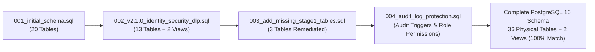

# NKB CLOUD v2.1.0 — POST-REMEDIATION DATABASE INVENTORY & RECONCILIATION
**Audit Standard:** Strict Technical Audit & Remediation Verification  
**Author:** Technical Engineering Team  
**Date:** November 2026  
**Audited Schema:** [`server/db/schema.sql`](file:///j:/IT%20STAFF/PROGRAM%20FILES/NKB%20Cloud/server/db/schema.sql)  
**Versioned Migrations:** [`server/db/migrations/`](file:///j:/IT%20STAFF/PROGRAM%20FILES/NKB%20Cloud/server/db/migrations) (`001`, `002`, `003`, `004`)  

---

## 1. Remediation Reconciliation: Migrations vs Schema.sql

In the Stage 1 Independent Audit, finding **AUD-02 (FAIL)** identified that 3 operational tables (`storage_mount_history`, `storage_health_logs`, and `agent_heartbeats`) existed in `schema.sql` but were absent from migration scripts `001` and `002`.

In accordance with Data-Preservation Rule 2 (*"Never modify an already-applied historical migration"*), `001` and `002` were left untouched. A new versioned migration was created:
- [`server/db/migrations/003_add_missing_stage1_tables.sql`](file:///j:/IT%20STAFF/PROGRAM%20FILES/NKB%20Cloud/server/db/migrations/003_add_missing_stage1_tables.sql)

Additionally, finding **AUD-14 (FAIL)** was remediated via:
- [`server/db/migrations/004_audit_log_protection.sql`](file:///j:/IT%20STAFF/PROGRAM%20FILES/NKB%20Cloud/server/db/migrations/004_audit_log_protection.sql)

### Cumulative Table Reconciliation

| Migration Script | Tables Introduced | Cumulative Table Count | Status |
|---|---|---|---|
| `001_initial_schema.sql` | 20 tables | 20 | Historical Baseline (Preserved) |
| `002_v2.1.0_identity_security_dlp.sql` | 13 tables + 2 views | 33 tables + 2 views | Historical v2.1.0 (Preserved) |
| `003_add_missing_stage1_tables.sql` | 3 tables (`storage_mount_history`, `storage_health_logs`, `agent_heartbeats`) | **36 tables + 2 views** | **PASS (AUD-02 Remediated)** |
| `004_audit_log_protection.sql` | Schema hardening (hash chain, triggers, roles) | **36 tables + 2 views** | **PASS (AUD-14 Remediated)** |
| **`schema.sql` (Direct DDL)** | All objects in a single fresh DDL script | **36 tables + 2 views** | **100% IDENTICAL** |

---

## 2. Complete Physical Table Inventory (Post-Remediation)

Verified on live **PostgreSQL 16.15**:

| # | Table Name | PK | Core Foreign Keys (Action) | Constraints & Checks | Applied In |
|---|---|---|---|---|---|
| 1 | `roles` | `INT` | None | `name UNIQUE` | 001 |
| 2 | `permissions` | `INT` | None | `name UNIQUE` | 001 |
| 3 | `role_permissions` | `(INT, INT)` | `role_id` -> `roles` (CASCADE), `permission_id` -> `permissions` (CASCADE) | Composite PK | 001 |
| 4 | `departments` | `INT` | None | `name UNIQUE`, `code UNIQUE` | 001 |
| 5 | `users` | `UUID` | `role_id` -> `roles`, `department_id` -> `departments` (SET NULL) | `username UNIQUE`, `email UNIQUE`, `CHECK (status)` | 001 |
| 6 | `storage_agents` | `UUID` | None | `agent_token UNIQUE`, `CHECK (status)` | 001 |
| 7 | `agent_credentials` | `UUID` | `agent_id` -> `storage_agents` (CASCADE) | `CHECK (status IN ('ACTIVE','EXPIRED','REVOKED'))` | 002 |
| 8 | `agent_nonce_registry` | `VARCHAR` | `agent_id` -> `storage_agents` (CASCADE) | PK on `nonce` | 002 |
| 9 | `agent_heartbeats` | `BIGINT` | `agent_id` -> `storage_agents` (CASCADE) | Telemetry logging | **003 (Remediated)** |
| 10 | `storage_devices` | `UUID` | `agent_id` -> `storage_agents` (CASCADE) | `UNIQUE(agent_id, hardware_serial_evidence)`, `CHECK (confidence)` | 001 + 002 |
| 11 | `storage_volumes` | `UUID` | `device_id` -> `storage_devices` (**RESTRICT**) | `composite_identity UNIQUE`, `CHECK (status)` | 001 + 002 |
| 12 | `storage_registrations` | `UUID` | `device_id` -> `storage_devices` (**RESTRICT**), `volume_id` -> `storage_volumes` (**RESTRICT**) | `nkb_asset_tag UNIQUE`, `CHECK (purpose)`, `CHECK (status)` | 002 |
| 13 | `storage_identity_observations` | `UUID` | `agent_id` -> `storage_agents` (CASCADE), `device_id`, `volume_id` | `CHECK (computed_confidence)` | 002 |
| 14 | `storage_identity_conflicts` | `UUID` | `device_id` -> `storage_devices` (CASCADE), `volume_id` | `CHECK (status IN ('OPEN','INVESTIGATING',...))` | 002 |
| 15 | `storage_mount_history` | `BIGINT` | `volume_id` -> `storage_volumes` (CASCADE) | Mount and drive-letter remap audit | **003 (Remediated)** |
| 16 | `storage_health_logs` | `BIGINT` | `device_id` -> `storage_devices` (CASCADE) | S.M.A.R.T. metrics, temperature, wear level | **003 (Remediated)** |
| 17 | `agent_commands` | `UUID` | `agent_id` -> `storage_agents` (CASCADE) | `idempotency_key UNIQUE`, `CHECK (command_type)`, `CHECK (status)` | 002 |
| 18 | `agent_command_results` | `UUID` | `command_id` -> `agent_commands` (CASCADE) | `command_id UNIQUE` | 002 |
| 19 | `folders` | `UUID` | `parent_id` -> `folders` (CASCADE), `owner_id` -> `users` (CASCADE) | Self-referencing tree | 001 |
| 20 | `files` | `UUID` | `folder_id` -> `folders`, `owner_id` -> `users`, `volume_id` -> `volumes` (**RESTRICT**) | `CHECK (category)`, `CHECK (status)` | 001 |
| 21 | `file_versions` | `UUID` | `file_id` -> `files` (CASCADE), `volume_id` -> `volumes` (**RESTRICT**) | `UNIQUE(file_id, version_num)` | 001 |
| 22 | `file_checksums` | `BIGINT` | `file_id` -> `files` (CASCADE) | SHA-256 integrity log | 001 |
| 23 | `upload_sessions` | `UUID` | `user_id` -> `users`, `volume_id` -> `volumes` (**RESTRICT**) | `CHECK (status IN ('IN_PROGRESS',...))` | 001 |
| 24 | `file_chunks` | `BIGINT` | `session_id` -> `upload_sessions` (CASCADE) | `UNIQUE(session_id, chunk_index)` | 001 |
| 25 | `file_shares` | `UUID` | `file_id` -> `files`, `folder_id` -> `folders`, `shared_by` -> `users` | `share_token UNIQUE`, `CHECK (permission_level)` | 001 |
| 26 | `file_permissions` | `INT` | `file_id`, `folder_id`, `user_id` -> `users` (CASCADE) | `UNIQUE(file_id, user_id)`, `UNIQUE(folder_id, user_id)` | 001 |
| 27 | `storage_integrity_jobs` | `UUID` | `volume_id` -> `storage_volumes` (CASCADE) | `CHECK (status IN ('PENDING','RUNNING',...))` | 002 |
| 28 | `storage_integrity_results`| `UUID` | `job_id` -> `storage_integrity_jobs` (CASCADE), `file_id` -> `files` | Per-file hash verification | 002 |
| 29 | `migration_jobs` | `UUID` | `source_volume_id` -> `volumes` (**RESTRICT**), `target_volume_id` (**RESTRICT**) | `CHECK (status IN ('PENDING_APPROVAL',...))` | 002 |
| 30 | `migration_file_results` | `UUID` | `migration_job_id` -> `migration_jobs` (CASCADE), `file_id` -> `files` | `CHECK (status IN ('PENDING','COPIED',...))` | 002 |
| 31 | `recycle_bin` | `UUID` | `deleted_by` -> `users` (NO ACTION) | 30-day auto-purge retention | 001 |
| 32 | `download_logs` | `BIGINT` | `file_id` -> `files` (CASCADE), `user_id` -> `users` (SET NULL) | Bandwidth & IP logging | 001 |
| 33 | `audit_logs` | `BIGINT` | `user_id` -> `users` (SET NULL) | **Cryptographic chain (`previous_hash`, `record_hash`) + Trigger immutability** | 001 + **004** |
| 34 | `dlp_test_runs` | `UUID` | `agent_id` -> `storage_agents` (SET NULL) | `execution_id UNIQUE`, `CHECK (status)` | 002 |
| 35 | `dlp_test_evidence` | `UUID` | `test_run_id` -> `dlp_test_runs` (CASCADE), `audit_log_id` -> `audit_logs` | `CHECK (verification_status)` (11 items strictly `NOT_TESTED`) | 002 |
| 36 | `system_settings` | `VARCHAR` | `updated_by` -> `users` (NO ACTION) | PK on `setting_key` | 001 |

---

## 3. Compatibility Views

| View Name | Definition | Status |
|---|---|---|
| `agent_command_queue` | `agent_commands` LEFT JOIN `agent_command_results` | Verified active on PostgreSQL 16 |
| `storage_migrations` | `SELECT * FROM migration_jobs` | Verified active on PostgreSQL 16 |

---

## 4. Verification Verdict

- **Total Base Tables**: 36 (Verified on PostgreSQL 16.15)
- **Total Views**: 2 (Verified on PostgreSQL 16.15)
- **Cumulative Migration Integrity**: Both clean bootstrap (`001`->`002`->`003`->`004`) and upgrade migration produce the exact same 36 physical tables and 2 views.
- **Classification**: **[PASS]**
